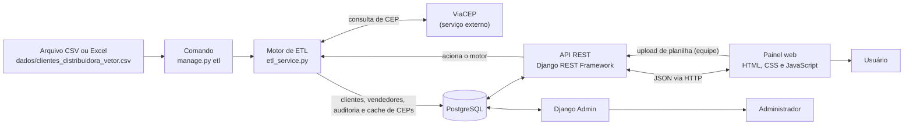
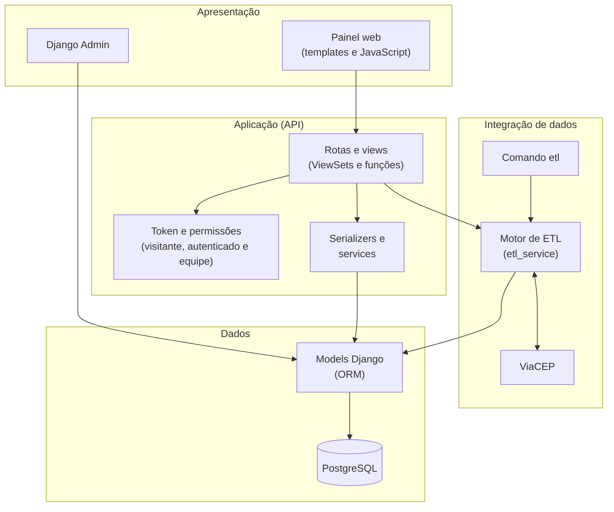
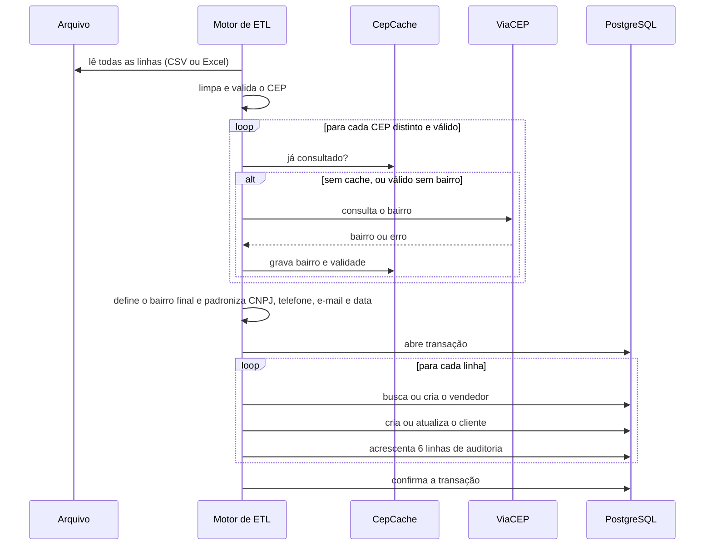
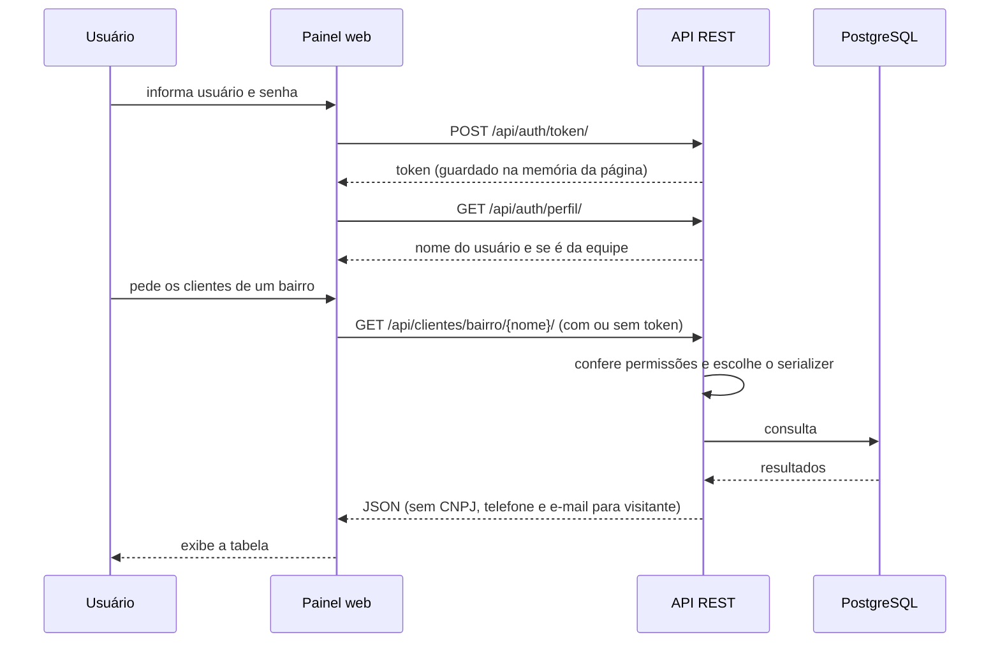

# Arquitetura do Sistema

Projeto Integrador: Distribuidora Vetor (ETL + API REST)

Este documento descreve a arquitetura **que o código atual do repositório
implementa** (branch `main`, commit `85d76d3`, de 24/11): o pipeline de ETL, o
banco de dados, a API REST, o painel web e o Django Admin.

## 1. Visão geral

Fluxo implementado: **arquivo CSV ou Excel → ETL → PostgreSQL → API REST →
painel web**, com o Django Admin lendo o mesmo banco. O motor do ETL também é
acionado pelo painel, na aba Normalização, quando a equipe envia uma planilha.

## 2. Componentes

| Componente | Responsabilidade | Onde está |
|------------|------------------|-----------|
| Arquivo CSV ou Excel | Fonte bruta dos clientes. | `dados/` |
| Comando do ETL | Lê o arquivo informado e chama o motor. | `management/commands/etl.py` |
| Motor de ETL | Lê CSV e Excel, limpa e padroniza CEP, bairro, CNPJ, telefone, e-mail e data, consulta o ViaCEP, carrega o banco e registra a auditoria. | `etl_service.py` |
| Normalizadores | Limpeza de CEP e chave de comparação de bairros, usadas pela API e pelos serviços. | `normalizadores.py` |
| ViaCEP | Devolver o bairro de cada CEP. | Serviço externo |
| PostgreSQL | Armazenar `Vendedor`, `Cliente`, `Auditoria` e `CepCache`. | Banco configurado no `.env` |
| Models | Definir as quatro tabelas e suas regras de integridade. | `models.py` |
| Serializers | Converter dados em JSON, validar UF, CNPJ, CEP e telefone na entrada e esconder os contatos do visitante. | `serializers.py` |
| Services | Consultas por bairro, por vendedor e o resumo por bairro. | `services.py` |
| Views | CRUD, permissões, paginação, erro 409, exportação, tabela de normalização e upload de planilha. | `views.py` |
| Rotas | Ligar endereços às views, ao token e à documentação. | `urls.py`, `config/urls.py` |
| Painel web | Telas de login, clientes, vendedores, relatórios e normalização, que consomem a API por `fetch`. | `templates/`, `static/`, `frontend_urls.py` |
| Django Admin | Listar, criar, editar e excluir vendedores, clientes e cache de CEPs; consultar a auditoria em modo de leitura. | `admin.py` |
| Documentação da API | Swagger, Redoc e esquema OpenAPI gerados pelo drf-spectacular. | `config/urls.py`, `openapi.yml` |

## 3. Camadas

O ETL, a API e o Admin usam os **mesmos models**, então enxergam as mesmas
tabelas e regras de integridade. O painel web é servido pelo próprio Django,
no mesmo endereço da API.

## 4. Fluxo do ETL

## 5. Fluxo de uma requisição à API

Regra de acesso:

| Perfil | O que pode |
|--------|------------|
| Visitante | Consultar clientes e vendedores, sem CNPJ, telefone e e-mail |
| Usuário autenticado | Tudo do visitante, mais ver os contatos, criar, alterar e excluir, e exportar a base |
| Equipe (`is_staff`) | Tudo do autenticado, mais a aba Normalização: tabela de tratamento e envio de planilhas |

## 6. Decisões de arquitetura presentes no código

| Decisão | Onde aparece |
|---------|--------------|
| Motor de ETL compartilhado entre o comando e o upload do painel | `etl_service.py`, usado por `etl.py` e `views.py` |
| Cache de CEPs em tabela do PostgreSQL | Modelo `CepCache` |
| Carga dentro de `transaction.atomic()` | `etl_service.py`: erro na carga desfaz clientes, vendedores e auditoria |
| Idempotência por `update_or_create` no `id_cliente` | `etl_service.py` e `id_cliente` único em `Cliente` |
| Auditoria acumulada (não é apagada entre execuções) | `etl_service.py` só acrescenta linhas |
| Modo "apenas exportar" sem gravar no banco | `processar_planilha_etl` com `persistir=False` |
| Auditoria sem criar nem alterar no Admin e fora da API de clientes | `admin.py` (`AuditoriaAdmin`) |
| Exclusão de vendedor com clientes bloqueada | `on_delete=RESTRICT` no modelo; a view traduz em resposta 409 |
| Permissão padrão: leitura para todos, escrita só com login; rotas de `admin-etl` só para a equipe | `IsAuthenticatedOrReadOnly`, `IsAdminUser` |
| Dois serializers de cliente (público e completo) | `serializers.py`: o visitante não recebe contatos |
| Consultas separadas das views | `services.py` |
| Painel web servido pelo Django, sem segundo servidor | `frontend_urls.py`, `templates/`, `static/`; evita CORS |
| Token e perfil guardados só em memória no painel | `api.js`: perdidos ao recarregar a página |
| Documentação gerada a partir do código | drf-spectacular (`/api/docs/`, `/api/redoc/`, `openapi.yml`) |

## 7. Pontos de atenção

- **Dependência externa do ETL:** a primeira consulta de cada CEP exige internet. Com o ViaCEP fora do ar, o ETL continua, mas o cliente fica sem o bairro do CEP.
- **Cache fora da transação:** o cache é gravado antes da transação de carga e permanece mesmo que a carga seja desfeita.
- **Auditoria cresce a cada execução** (6 linhas por cliente).
- **Formatos diferentes de CNPJ e telefone** entre o ETL (máscara e espaço) e a API (só dígitos).
- **`openapi.yml` desatualizado:** não inclui as rotas de exportação, perfil e `admin-etl`. As páginas Swagger e Redoc mostram o esquema gerado na hora; o arquivo é uma cópia antiga.
- **Documentação e internet:** as páginas Swagger e Redoc carregam arquivos de uma CDN.
- **Token em memória:** recarregar o painel exige novo login.
- **Configuração:** sem `SECRET_KEY` no `.env`, o `settings.py` usa uma chave local de desenvolvimento.
- **Não implementado no código analisado:** detecção de conflito de bairro, padronização do bairro devolvido pelo ViaCEP e testes automatizados do ETL.
