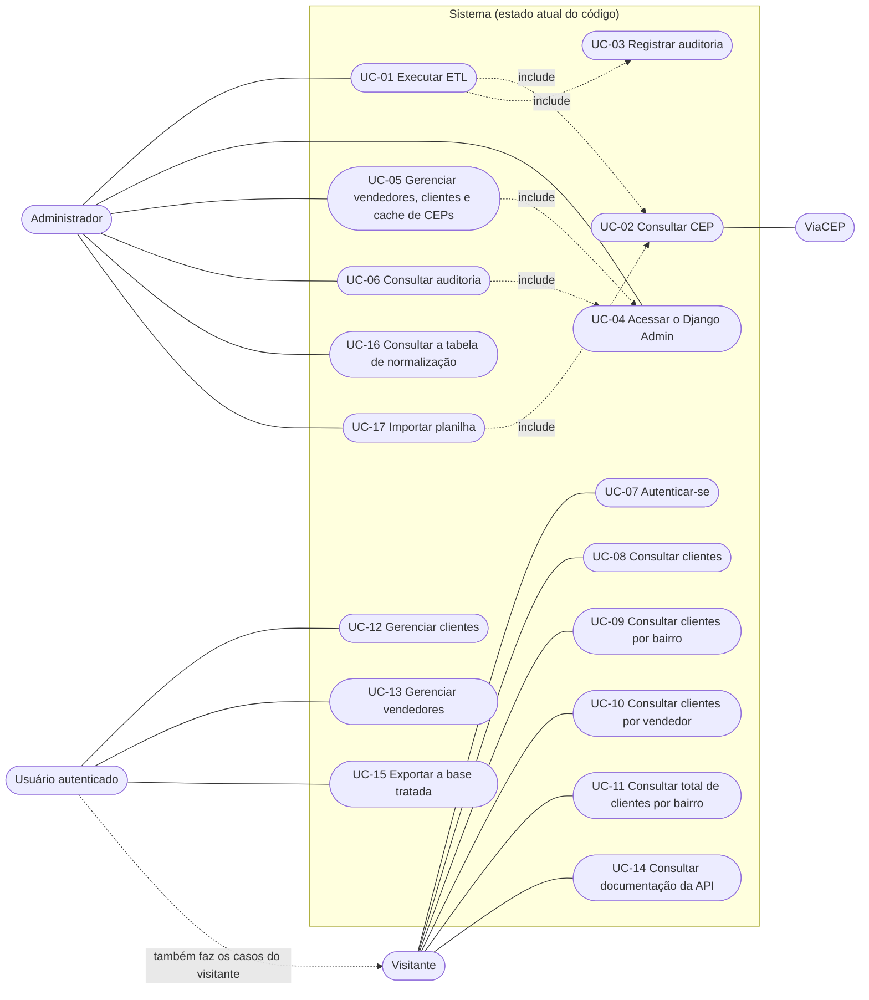

# Casos de Uso

Projeto Integrador: Distribuidora Vetor (ETL + API REST)

Este documento descreve os casos de uso **que o código atual do repositório
realmente executa** (branch `main`, commit `85d76d3`). Ele foi escrito a partir
de `models.py`, `admin.py`, `etl_service.py`, `etl.py`, `serializers.py`,
`services.py`, `views.py`, das rotas, dos arquivos do painel web e dos testes. O que ainda não
existe no código está listado na seção 5.

## 1. Atores

| Ator | Descrição |
|------|-----------|
| Administrador | Pessoa da equipe (`is_staff`) que executa o ETL no terminal, acessa o Django Admin e usa a aba Normalização do painel web. |
| Visitante | Pessoa sem login. Consulta clientes e vendedores pela API e pelo painel web, sem ver CNPJ, telefone e e-mail. |
| Usuário autenticado | Pessoa com token. Faz tudo o que o visitante faz, vê os dados de contato e cria, altera e exclui clientes e vendedores. |
| ViaCEP | Serviço externo que devolve o bairro de um CEP. Participa apenas do ETL. |

## 2. Diagrama de casos de uso

O visitante passa a ser usuário autenticado ao concluir o UC-07.

## 3. Lista dos casos de uso

| ID | Caso de uso | Ator principal | Onde está no código | Requisitos |
|----|-------------|----------------|---------------------|------------|
| UC-01 | Executar ETL | Administrador | `etl.py`, `etl_service.py` | RF-01 a RF-08 |
| UC-02 | Consultar CEP | ETL (ator secundário: ViaCEP) | `etl_service.py` (consulta e `CepCache`) | RF-04 |
| UC-03 | Registrar auditoria | ETL | `etl_service.py` (`Auditoria`) | RF-06 |
| UC-04 | Acessar o Django Admin | Administrador | Django (`/admin/`) | RF-18 |
| UC-05 | Gerenciar vendedores, clientes e cache de CEPs | Administrador | `admin.py` | RF-18 |
| UC-06 | Consultar auditoria | Administrador | `admin.py` (`AuditoriaAdmin`) | RF-06, RF-18 |
| UC-07 | Autenticar-se | Visitante | `config/urls.py`, `auth.js` | RF-15, RF-20 |
| UC-08 | Consultar clientes | Visitante, Usuário autenticado | `ClienteViewSet`, `clientes.js` | RF-10, RF-21 |
| UC-09 | Consultar clientes por bairro | Visitante, Usuário autenticado | `buscar_por_bairro`, `services.py` | RF-12, RF-22 |
| UC-10 | Consultar clientes por vendedor | Visitante, Usuário autenticado | `buscar_por_vendedor`, `listar_clientes` | RF-14, RF-22 |
| UC-11 | Consultar total de clientes por bairro | Visitante, Usuário autenticado | `listar_bairros`, `relatorios.js` | RF-13, RF-26, RF-28 |
| UC-12 | Gerenciar clientes (criar, alterar, excluir) | Usuário autenticado | `ClienteViewSet`, `serializers.py` | RF-10, RF-16, RF-23, RF-24 |
| UC-13 | Gerenciar vendedores (criar, alterar, excluir) | Usuário autenticado | `VendedorViewSet` | RF-11, RF-16, RF-25 |
| UC-14 | Consultar documentação da API | Visitante | `config/urls.py` | RF-17 |
| UC-15 | Exportar a base tratada | Usuário autenticado | `exportar_clientes_limpos`, `clientes.js` | RF-29 |
| UC-16 | Consultar a tabela de normalização | Administrador | `tabela_normalizacao_admin`, `normalizacao.js` | RF-30 |
| UC-17 | Importar planilha | Administrador | `processar_planilha_etl`, `normalizacao.js` | RF-31 |

## 4. Descrição dos casos de uso

### UC-01: Executar ETL

| Item | Descrição |
|------|-----------|
| Ator principal | Administrador |
| Ator secundário | ViaCEP |
| Pré-condições | Ambiente virtual ativo, PostgreSQL em execução, migrações aplicadas e o arquivo de dados presente (por padrão, `dados/clientes_distribuidora_vetor.csv`). |
| Pós-condição | Clientes, vendedores e auditoria gravados no banco; resumo no terminal. |

**Fluxo principal**
1. O administrador executa `python manage.py etl` (ou `python manage.py etl --arquivo caminho` para outro CSV ou Excel).
2. O sistema exibe `Iniciando ETL a partir de: ...`, lê o arquivo (separador detectado, tudo como texto, vazios como nulo) e informa o total de linhas.
3. O sistema limpa o CEP de cada linha e classifica o resultado.
4. Para cada CEP distinto e válido, o sistema usa o cache ou consulta o ViaCEP (UC-02).
5. Para cada linha, o sistema define o bairro final (o do ViaCEP, quando responde; senão, o bairro informado canonizado por palavra-chave) e padroniza CNPJ, telefone, e-mail e data.
6. O sistema abre uma transação e, para cada linha: busca ou cria o vendedor (nome vazio vira `Vendedor Desconhecido`), cria ou atualiza o cliente pelo `id_cliente`, marca `precisa_revisao` quando o bairro final é nulo e registra a auditoria (UC-03).
7. O sistema confirma a transação e exibe `ETL Concluído! N processados (X criados, Y atualizados).`

**Fluxos alternativos**
- *2a. Arquivo ausente, formato inválido ou colunas obrigatórias faltando:* o sistema exibe `Erro ao ler arquivo` com o motivo e encerra sem gravar nada.
- *3a. CEP vazio, genérico, sem dígitos ou com mais de 8 dígitos:* o CEP é gravado como nulo e o cliente segue com o bairro informado.
- *4a. CEP que o ViaCEP não reconhece:* o CEP do cliente é gravado como nulo, a auditoria registra `Inválido: Reprovado no ViaCEP` e o cliente segue com o bairro informado.
- *4b. ViaCEP indisponível ou com resposta diferente de 200:* nada é guardado no cache; o CEP continua válido e o cliente segue sem o bairro do ViaCEP.
- *6a. Cliente sem bairro (nem do ViaCEP, nem informado):* `precisa_revisao` fica verdadeiro.
- *6b. Erro durante a carga:* a transação é desfeita; clientes, vendedores e auditoria não ficam gravados pela metade. O cache de CEPs, gravado antes, permanece.
- *Reexecução:* clientes existentes (mesmo `id_cliente`) são atualizados, sem duplicar, e a auditoria ganha novas linhas, sem apagar as anteriores.

**Observações sobre o que o ETL não faz**
- Quando o ViaCEP devolve um bairro, ele substitui o bairro digitado. Não há detecção de conflito nem revisão nesses casos.
- O bairro devolvido pelo ViaCEP não é padronizado, e a subdivisão (Norte, Sul, I, II) não tem coluna própria.

### UC-02: Consultar CEP

| Item | Descrição |
|------|-----------|
| Ator principal | ETL |
| Ator secundário | ViaCEP |
| Pré-condição | CEP já limpo e válido (UC-01, passo 3). |
| Pós-condição | CEP disponível para o ETL, com bairro e indicação de validade. |

**Fluxo principal**
1. O sistema procura o CEP na tabela `CepCache`. Se existe como não válido, ou como válido e com bairro, usa o resultado guardado.
2. Caso contrário, consulta `viacep.com.br` (limite de 5 segundos).
3. Se a resposta é bem-sucedida e sem erro, o sistema grava o bairro e marca o CEP como válido.
4. O sistema aguarda 0,1 segundo antes do próximo CEP.

**Fluxos alternativos**
- *3a. Resposta com indicação de CEP inexistente:* o sistema grava o CEP como não válido, sem bairro.
- *3b. Falha de rede ou resposta diferente de 200:* nada é gravado, e o ETL segue sem o bairro desse CEP.

### UC-03: Registrar auditoria

| Item | Descrição |
|------|-----------|
| Ator principal | ETL |
| Pré-condição | Cliente gravado ou atualizado (UC-01, passo 6). |
| Pós-condição | Seis linhas de auditoria para o cliente. |

**Fluxo principal**
1. Para cada cliente processado, o sistema cria um registro na tabela `Auditoria` para cada um destes campos: `cep`, `bairro`, `cnpj`, `telefone`, `email` e `data_cadastro`.
2. O registro guarda o valor original, o valor tratado e o critério (por exemplo, `Válido: Máscara aplicada` ou `Canonizado: De "x" para "y"`).

**Observação:** as linhas anteriores não são apagadas, então a tabela cresce a cada execução. Razão social, cidade, UF e vendedor só passam por limpeza simples e não são auditados.

### UC-04: Acessar o Django Admin

| Item | Descrição |
|------|-----------|
| Ator principal | Administrador |
| Pré-condição | Servidor em execução (`python manage.py runserver`) e superusuário criado (`python manage.py createsuperuser`). |
| Pós-condição | Administrador autenticado no painel. |

**Fluxo principal**
1. O administrador abre `http://127.0.0.1:8000/admin/`.
2. Informa usuário e senha do superusuário.
3. O sistema exibe as tabelas Vendedor, Cliente, Cep caches e Auditoria.

**Fluxo alternativo**
- *2a. Credenciais inválidas:* o Admin recusa o acesso e pede os dados novamente.

### UC-05: Gerenciar vendedores, clientes e cache de CEPs

| Item | Descrição |
|------|-----------|
| Ator principal | Administrador |
| Pré-condição | Acesso ao Admin (UC-04). |
| Pós-condição | Registros listados, criados, alterados ou excluídos. |

**Fluxo principal**
1. O administrador escolhe Vendedor, Cliente ou Cep cache.
2. Lista os registros e pode criar, editar ou excluir, com o comportamento padrão do Django Admin (essas três tabelas são registradas sem restrições).

**Fluxo alternativo**
- *Exclusão de vendedor que tem clientes:* a regra `RESTRICT` do modelo impede a exclusão.
- *Exclusão de cliente:* as auditorias dele são apagadas junto (`CASCADE`).

### UC-06: Consultar auditoria

| Item | Descrição |
|------|-----------|
| Ator principal | Administrador |
| Pré-condição | Acesso ao Admin (UC-04) e ETL já executado. |
| Pós-condição | Registros de auditoria exibidos. |

**Fluxo principal**
1. O administrador abre a tabela Auditoria.
2. O sistema lista os registros e permite abrir cada um, com todos os campos em modo de leitura.

**Fluxos alternativos**
- *Tentativa de adicionar ou alterar um registro:* o Admin não permite.
- *Exclusão:* **não está bloqueada** no código atual (`has_delete_permission` não foi sobrescrito).

### UC-07: Autenticar-se

| Item | Descrição |
|------|-----------|
| Ator principal | Visitante |
| Pré-condição | Existir um usuário cadastrado (por exemplo, criado pelo Administrador com `createsuperuser`). |
| Pós-condição | O visitante passa a ser usuário autenticado e recebe um token. |

**Fluxo principal**
1. O visitante abre `/entrar/` e informa usuário e senha.
2. O painel envia os dados para `/api/auth/token/` (a rota `/api/token/` faz o mesmo).
3. A API devolve o token, e o painel o guarda na memória da página.
4. O painel consulta `/api/auth/perfil/` para saber o nome do usuário e se ele é da equipe (`is_staff`).
5. O painel mostra o nome do usuário, libera os botões de escrita e os de exportação, e mostra a aba Normalização apenas para a equipe.

**Fluxos alternativos**
- *2a. Credenciais inválidas:* a API recusa a solicitação e o painel exibe o erro, sem guardar token.
- *Sair:* o botão Sair apaga o token da memória e o painel volta ao modo visitante.
- *Recarregar a página:* o token é perdido (fica só em memória) e o painel volta ao modo visitante.
- *Seguir como visitante:* a tela de login oferece essa opção, sem autenticação.

### UC-08: Consultar clientes

| Item | Descrição |
|------|-----------|
| Atores | Visitante, Usuário autenticado |
| Pré-condição | Clientes carregados pelo ETL. |
| Pós-condição | Lista paginada de clientes exibida. |

**Fluxo principal**
1. O ator abre `/clientes/` ou chama `GET /api/clientes/`.
2. O sistema devolve os clientes ordenados, 20 por página, com os botões Anterior e Próxima no painel.
3. O ator abre um cliente (Visualizar) para ver os detalhes.

**Fluxos alternativos**
- *Visitante:* a resposta não traz CNPJ, telefone nem e-mail.
- *Filtro de revisão:* `?precisa_revisao=true` ou `false` limita a lista; outro valor responde 400.
- *Cliente inexistente:* a API responde 404.

### UC-09: Consultar clientes por bairro

| Item | Descrição |
|------|-----------|
| Atores | Visitante, Usuário autenticado |
| Pré-condição | Clientes carregados pelo ETL. |
| Pós-condição | Lista paginada dos clientes do bairro exibida. |

**Fluxo principal**
1. O ator informa um bairro no campo de busca do painel ou em `/api/clientes/bairro/{nome}/`.
2. O sistema compara o nome ignorando maiúsculas, acentos e pontuação (por exemplo, `aguas-claras` encontra `Águas Claras`).
3. O sistema devolve os clientes cujo bairro gravado tem o mesmo nome comparável.

**Fluxos alternativos**
- *Variantes de grafia:* nomes como `Águas Claras/DF`, `Vte Pires` ou `Águas Claras Sul` não são unificados e contam como outros bairros.
- *Bairro sem clientes:* a lista vem vazia.
- *Painel:* a busca por bairro não aceita pontos nem barras.

### UC-10: Consultar clientes por vendedor

| Item | Descrição |
|------|-----------|
| Atores | Visitante, Usuário autenticado |
| Pré-condição | Vendedor cadastrado. |
| Pós-condição | Clientes do vendedor exibidos. |

**Fluxo principal**
1. O ator escolhe um vendedor no filtro do painel, ou chama `/api/clientes/vendedor/{id}/` ou `/api/vendedores/{id}/clientes/`.
2. O sistema devolve os clientes ligados àquele vendedor.

**Fluxo alternativo**
- *Vendedor inexistente:* a API responde 404.

### UC-11: Consultar total de clientes por bairro

| Item | Descrição |
|------|-----------|
| Atores | Visitante, Usuário autenticado |
| Pré-condição | Clientes carregados pelo ETL. |
| Pós-condição | Resumo por bairro e lista de clientes para revisão exibidos. |

**Fluxo principal**
1. O ator abre `/relatorios/` ou chama `GET /api/clientes/bairros/`.
2. O sistema agrupa os bairros ignorando maiúsculas, acentos e pontuação e conta os clientes de cada grupo.
3. O painel mostra a tabela Clientes por bairro e a lista Clientes que precisam de revisão.

**Fluxo alternativo**
- *Clientes sem bairro:* formam um grupo próprio, com bairro nulo.

### UC-12: Gerenciar clientes

| Item | Descrição |
|------|-----------|
| Ator principal | Usuário autenticado |
| Pré-condição | Token válido e pelo menos um vendedor cadastrado. |
| Pós-condição | Cliente criado, alterado ou excluído. |

**Fluxo principal**
1. O usuário escolhe Novo cliente, Editar ou Excluir.
2. Na criação e na edição, preenche o formulário e escolhe o vendedor responsável.
3. A API valida os dados: UF existente, CNPJ, CEP e telefone em formato válido. Os valores são gravados em formato padronizado (UF em maiúsculas, CNPJ e telefone só com dígitos, CEP com 8 dígitos).
4. Na exclusão, o painel pede confirmação antes de apagar.

**Fluxos alternativos**
- *3a. Dados inválidos:* a API responde 400 e o painel mostra a mensagem de cada campo.
- *Visitante:* a API recusa a escrita com 401 e o painel oculta os botões Novo cliente, Editar e Excluir.
- *Cliente inexistente:* a API responde 404.
- *Campo `precisa_revisao`:* não pode ser alterado pela API.
- *Sem vendedores:* o painel orienta cadastrar um vendedor antes.

### UC-13: Gerenciar vendedores

Funciona como o UC-12, com os campos nome e identificador.

**Fluxo alternativo específico**
- *Exclusão de vendedor que tem clientes:* a API responde 409 com a mensagem `Não é possível excluir um vendedor que possui clientes vinculados.` e o painel mostra um aviso para transferir os vínculos antes.

### UC-14: Consultar documentação da API

| Item | Descrição |
|------|-----------|
| Ator principal | Visitante |
| Pós-condição | Documentação exibida. |

**Fluxo principal**
1. O ator abre `/api/docs/` (Swagger), `/api/redoc/` (Redoc) ou `/api/schema/` (esquema OpenAPI).
2. O sistema exibe a documentação gerada a partir do código.

**Observação:** as páginas de documentação carregam arquivos de uma CDN, então precisam de internet.

### UC-15: Exportar a base tratada

| Item | Descrição |
|------|-----------|
| Ator principal | Usuário autenticado |
| Pré-condição | Token válido. |
| Pós-condição | Arquivo CSV ou Excel baixado com os dados finais dos clientes. |

**Fluxo principal**
1. O usuário clica em Exportar CSV ou Exportar Excel em `/clientes/` (ou chama `GET /api/clientes/exportar/?formato=csv` ou `xlsx`).
2. O sistema monta uma tabela com id, razão social, CNPJ, telefone, e-mail, bairro, CEP, cidade, UF, data de cadastro e vendedor, ordenada pelo `id_cliente`.
3. O navegador baixa o arquivo `clientes_vetor_normalizados`.

**Fluxos alternativos**
- *Visitante:* os botões ficam ocultos e a API recusa o pedido com 401.
- *Formato diferente de `csv`:* o sistema devolve o arquivo em Excel.

### UC-16: Consultar a tabela de normalização

| Item | Descrição |
|------|-----------|
| Ator principal | Administrador (`is_staff`) |
| Pré-condição | Login com usuário da equipe e ETL já executado. |
| Pós-condição | Tabela com o valor original, o valor final e o critério de cada campo exibida. |

**Fluxo principal**
1. O administrador entra no painel e abre a aba Normalização.
2. O painel chama `GET /api/admin-etl/tabela/`.
3. O sistema devolve, para cada cliente, CEP, bairro, CNPJ, telefone, e-mail e data com o valor original, o valor tratado e o critério do registro de auditoria mais recente.

**Fluxos alternativos**
- *Usuário sem permissão de equipe:* a aba fica oculta e a API recusa o pedido.
- *Campo sem auditoria:* o critério aparece como `Sem registro`.

### UC-17: Importar planilha

| Item | Descrição |
|------|-----------|
| Ator principal | Administrador (`is_staff`) |
| Ator secundário | ViaCEP |
| Pré-condição | Login com usuário da equipe e arquivo `.csv` ou `.xlsx` com as colunas obrigatórias. |
| Pós-condição | Dados gravados no banco ou planilha tratada baixada, conforme o modo escolhido. |

**Fluxo principal**
1. O administrador escolhe o arquivo na aba Normalização e define o modo (salvar no banco ou apenas exportar) e o formato do arquivo de saída.
2. O painel envia o arquivo para `POST /api/admin-etl/processar/`.
3. O sistema aplica as mesmas regras do UC-01, inclusive a consulta de CEP (UC-02).
4. No modo **salvar**, grava clientes e auditoria e devolve o resumo (processados, criados e atualizados).
5. No modo **apenas exportar**, não grava clientes nem auditoria e devolve a planilha tratada em CSV ou Excel.

**Fluxos alternativos**
- *Arquivo ausente, formato inválido ou colunas faltando:* a API responde 400 com a mensagem.
- *Usuário sem permissão de equipe:* a API recusa o pedido.

## 5. O que o código atual não cobre

Estes itens fazem parte do enunciado e do roadmap, mas não existem nos arquivos analisados, por isso não há casos de uso para eles:

- Detecção de conflito entre o bairro digitado e o do CEP, com envio para revisão
- Padronização do bairro devolvido pelo ViaCEP e coluna própria para a subdivisão
- Validação dos dígitos do CNPJ e uso da BrasilAPI
- Testes automatizados do ETL e das rotas de exportação e de `admin-etl`
- Normalização do bairro recebido pela API
