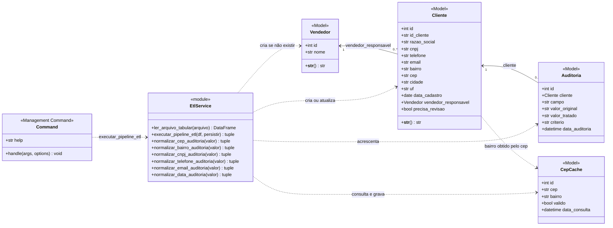
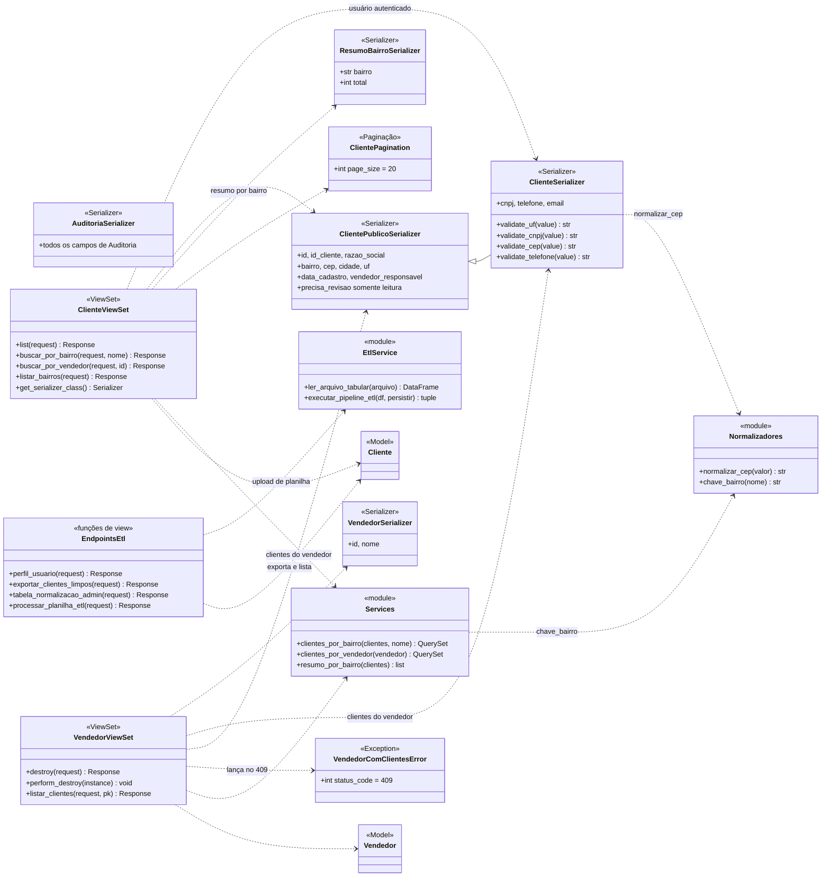

# Diagrama de Classes

Projeto Integrador: Distribuidora Vetor (ETL + API REST)

Este documento apresenta o diagrama de classes do sistema (branch `main`,
commit `85d76d3`). Ele foi construído a partir de `models.py` (classes de
domínio), `etl.py` e `etl_service.py` (ETL), `normalizadores.py`, `services.py`,
`serializers.py` e `views.py` (API).

São dois diagramas: o primeiro mostra o domínio e o ETL; o segundo, a API.

## 1. Domínio e ETL

## 2. API

## 3. Descrição das classes de domínio

| Classe | Papel | Observações |
|--------|-------|-------------|
| `Vendedor` | Representa o vendedor responsável por clientes. | Só tem o nome. |
| `Cliente` | Representa o cliente da distribuidora, com dados cadastrais e o bairro final. | `id_cliente` é único e identifica o registro de origem no CSV. `precisa_revisao` marca registros que exigem conferência. |
| `Auditoria` | Registra o valor original, o valor tratado e o critério aplicado. | O ETL grava 6 campos por cliente (`cep`, `bairro`, `cnpj`, `telefone`, `email`, `data_cadastro`) e não apaga o histórico. No Admin não se cria nem se edita; a exclusão não está bloqueada. |
| `CepCache` | Guarda o resultado da consulta de cada CEP ao ViaCEP. | `valido` indica se o CEP existe e se a consulta funcionou. |
| `Command` | Comando `python manage.py etl`. | Lê o arquivo e chama `EtlService`; a lógica de tratamento fica no serviço. |
| `EtlService` | Motor do ETL (`etl_service.py`). | Lê CSV e Excel, padroniza os campos, consulta o ViaCEP e carrega o banco numa transação. Também é usado pelo upload de planilha do painel. |

## 4. Descrição das classes da API

| Classe ou módulo | Papel |
|------------------|-------|
| `ClientePublicoSerializer` | Dados do cliente sem CNPJ, telefone e e-mail; é o que o visitante recebe. |
| `ClienteSerializer` | Dados completos do cliente, com validação de UF, CNPJ, CEP e telefone na entrada. |
| `VendedorSerializer` | Dados do vendedor (todos os campos do modelo). |
| `ResumoBairroSerializer` | Formato do resumo de clientes por bairro (`bairro` e `total`). |
| `AuditoriaSerializer` | Existe, mas nenhuma view o usa: a auditoria não é exposta pela API. |
| `ClienteViewSet` | CRUD de clientes e as rotas por bairro, por vendedor e o resumo por bairro. |
| `VendedorViewSet` | CRUD de vendedores, a rota de clientes do vendedor e a resposta 409 na exclusão. |
| `ClientePagination` | Paginação de 20 clientes por página. |
| `VendedorComClientesError` | Exceção que produz a resposta 409. |
| `EndpointsEtl` | Funções de view para o perfil do usuário, a exportação da base (CSV ou Excel), a tabela de normalização e o envio de planilha (só equipe). |
| `Services` | Consultas por bairro e por vendedor e o resumo por bairro (módulo `services.py`). |
| `Normalizadores` | Limpeza de CEP e chave de comparação de bairros (módulo `normalizadores.py`), usado pela API e pelos serviços. O ETL atual tem as próprias regras em `EtlService`. |

## 5. Relacionamentos do domínio

| Origem | Destino | Cardinalidade | Regra ao apagar | Nome reverso no Django |
|--------|---------|---------------|-----------------|------------------------|
| `Cliente` | `Vendedor` | N para 1 | `RESTRICT`: não apaga o vendedor se ele tiver clientes | `vendedor.clientes` |
| `Auditoria` | `Cliente` | N para 1 | `CASCADE`: apagar o cliente apaga suas auditorias | `cliente.auditorias` |
| `Cliente` | `CepCache` | N para 1 (lógico) | Sem chave estrangeira; a ligação é pelo valor do `cep` | não se aplica |

## 6. Observações

- Todas as classes de domínio herdam de `models.Model` do Django, que acrescenta o campo `id` (chave primária automática) e os métodos de acesso ao banco. Eles não aparecem no diagrama para não poluí-lo.
- As setas tracejadas indicam **dependência**: uma classe usa a outra.
- Os tipos do diagrama são tipos Python. Os tipos e tamanhos das colunas no banco estão em `MODELO_DE_DADOS.md`.
- As regras do ETL ficam em `etl_service.py`, como funções de um módulo, e não como classes. A API usa um conjunto separado de normalizadores e validadores (`normalizadores.py` e `serializers.py`).
- As views e os serializers herdam de classes do Django REST Framework (`ModelViewSet`, `ModelSerializer`), que também não aparecem no diagrama.
