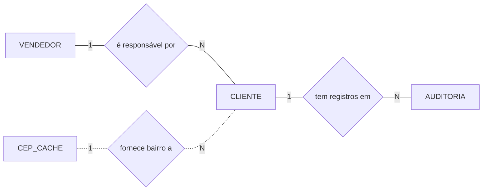
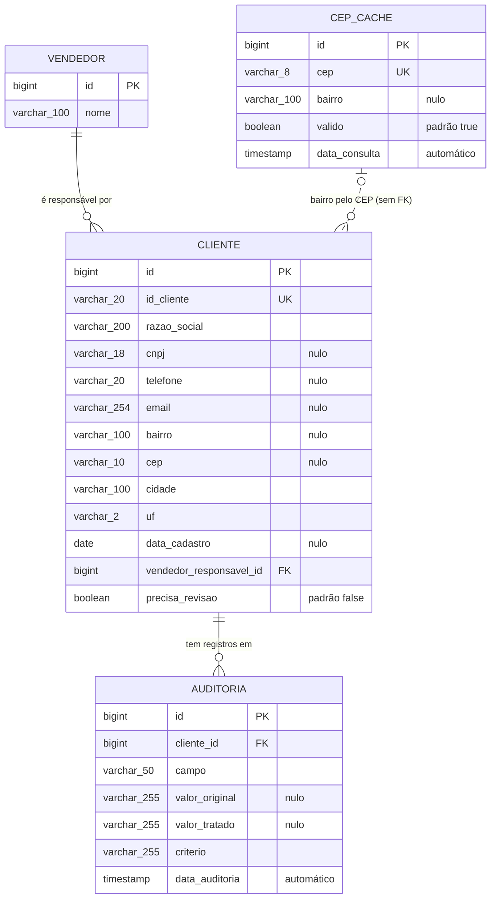

# Modelo de Dados

Projeto Integrador: Distribuidora Vetor (ETL + API REST)

Este documento descreve o modelo de dados do sistema em dois níveis:
o **MER** (modelo conceitual: entidades e relacionamentos) e o **DER**
(modelo lógico: tabelas, colunas, chaves e tipos no PostgreSQL).
Fonte: `distribuidora/models.py`.

## 1. MER (modelo conceitual)

**Leitura do MER**

| Relacionamento | Cardinalidade | Significado |
|----------------|---------------|-------------|
| VENDEDOR responsável por CLIENTE | 1 : N | Todo cliente tem exatamente um vendedor responsável; um vendedor pode ter vários clientes. |
| CLIENTE tem registros em AUDITORIA | 1 : N | Cada alteração feita pelo ETL num campo do cliente gera um registro de auditoria. |
| CEP_CACHE fornece bairro a CLIENTE | 1 : N (lógico) | O bairro consultado no ViaCEP para um CEP serve a todos os clientes com aquele CEP. Não há chave estrangeira: a ligação é pelo número do CEP (linha tracejada). |

## 2. DER (modelo lógico)

## 3. Dicionário de dados

### VENDEDOR

| Coluna | Tipo | Nulo | Restrições | Descrição |
|--------|------|------|------------|-----------|
| id | bigint | não | PK, automático | Identificador interno. |
| nome | varchar(100) | não | | Nome do vendedor. |

### CLIENTE

| Coluna | Tipo | Nulo | Restrições | Descrição |
|--------|------|------|------------|-----------|
| id | bigint | não | PK, automático | Identificador interno. |
| id_cliente | varchar(20) | não | único | Código do cliente vindo do CSV; é a chave que torna o ETL idempotente. |
| razao_social | varchar(200) | não | | Razão social. |
| cnpj | varchar(18) | sim | | CNPJ (18 caracteres comportam o formato com máscara). |
| telefone | varchar(20) | sim | | Telefone. |
| email | varchar(254) | sim | | E-mail. |
| bairro | varchar(100) | sim | | Bairro final, após a regra de decisão do ETL. |
| cep | varchar(10) | sim | | CEP; o ETL grava 8 dígitos. |
| cidade | varchar(100) | não | | Cidade. |
| uf | varchar(2) | não | | Sigla do estado. |
| data_cadastro | date | sim | | Data de cadastro. |
| vendedor_responsavel_id | bigint | não | FK → VENDEDOR, `RESTRICT` | Vendedor responsável. |
| precisa_revisao | boolean | não | padrão `false` | Indica registro que exige conferência humana. |

### AUDITORIA

| Coluna | Tipo | Nulo | Restrições | Descrição |
|--------|------|------|------------|-----------|
| id | bigint | não | PK, automático | Identificador interno. |
| cliente_id | bigint | não | FK → CLIENTE, `CASCADE` | Cliente cujo campo foi tratado. |
| campo | varchar(50) | não | | Nome do campo tratado: `cep`, `bairro`, `cnpj`, `telefone`, `email` ou `data_cadastro`. |
| valor_original | varchar(255) | sim | | Valor como veio no CSV. |
| valor_tratado | varchar(255) | sim | | Valor após o tratamento. |
| criterio | varchar(255) | não | | Regra aplicada, em texto (por exemplo, `Válido: Máscara aplicada`, `Canonizado: De "x" para "y"` ou `Inválido: Reprovado no ViaCEP`). |
| data_auditoria | timestamp | não | preenchido automaticamente | Momento do registro. |

### CEP_CACHE

| Coluna | Tipo | Nulo | Restrições | Descrição |
|--------|------|------|------------|-----------|
| id | bigint | não | PK, automático | Identificador interno. |
| cep | varchar(8) | não | único | CEP consultado (só dígitos). |
| bairro | varchar(100) | sim | | Bairro devolvido pelo ViaCEP. |
| valido | boolean | não | padrão `true` | `false` se o CEP não existe ou a consulta falhou. |
| data_consulta | timestamp | não | preenchido automaticamente | Momento da consulta. |

## 4. Regras de integridade

- **`RESTRICT` em Cliente → Vendedor:** não é possível apagar um vendedor que tenha clientes. A API traduz isso em resposta 409.
- **`CASCADE` em Auditoria → Cliente:** ao apagar um cliente, suas linhas de auditoria também são apagadas.
- **`id_cliente` único:** impede duplicar clientes ao rodar o ETL mais de uma vez.
- **`cep` único em CEP_CACHE:** cada CEP tem um único registro de cache; só é consultado de novo se estiver sem bairro e válido, ou ausente.
- **Auditoria no Django Admin:** o Admin não permite criar nem editar registros; a exclusão não está bloqueada no código atual. A API não expõe a auditoria.

## 5. Observações sobre o preenchimento

- O ETL preenche todos os campos do cliente. O **CNPJ** é gravado com máscara (`00.000.000/0000-00`, que cabe nos 18 caracteres), o **telefone** como `DD 9XXXX-XXXX` ou `DD XXXX-XXXX`, o **CEP** com 8 dígitos, a **UF** em maiúsculas e a **data** como `AAAA-MM-DD`.
- A **API** grava o CNPJ e o telefone **só com dígitos**. Na mesma coluna podem conviver os dois formatos: o do ETL e o da API.
- A **auditoria** recebe 6 linhas por cliente em cada execução do ETL (`cep`, `bairro`, `cnpj`, `telefone`, `email` e `data_cadastro`) e não é apagada entre execuções.
- O bairro gravado pode ser o devolvido pelo ViaCEP, no formato original dele (por exemplo, `Sul (Águas Claras)`), ou o resultado da canonização por palavra-chave. A subdivisão não tem coluna própria.
- Na API, os clientes e os vendedores são identificados pelo número `id` do registro. O `id_cliente` do CSV é um dado do cliente, e não aparece nos endereços.
