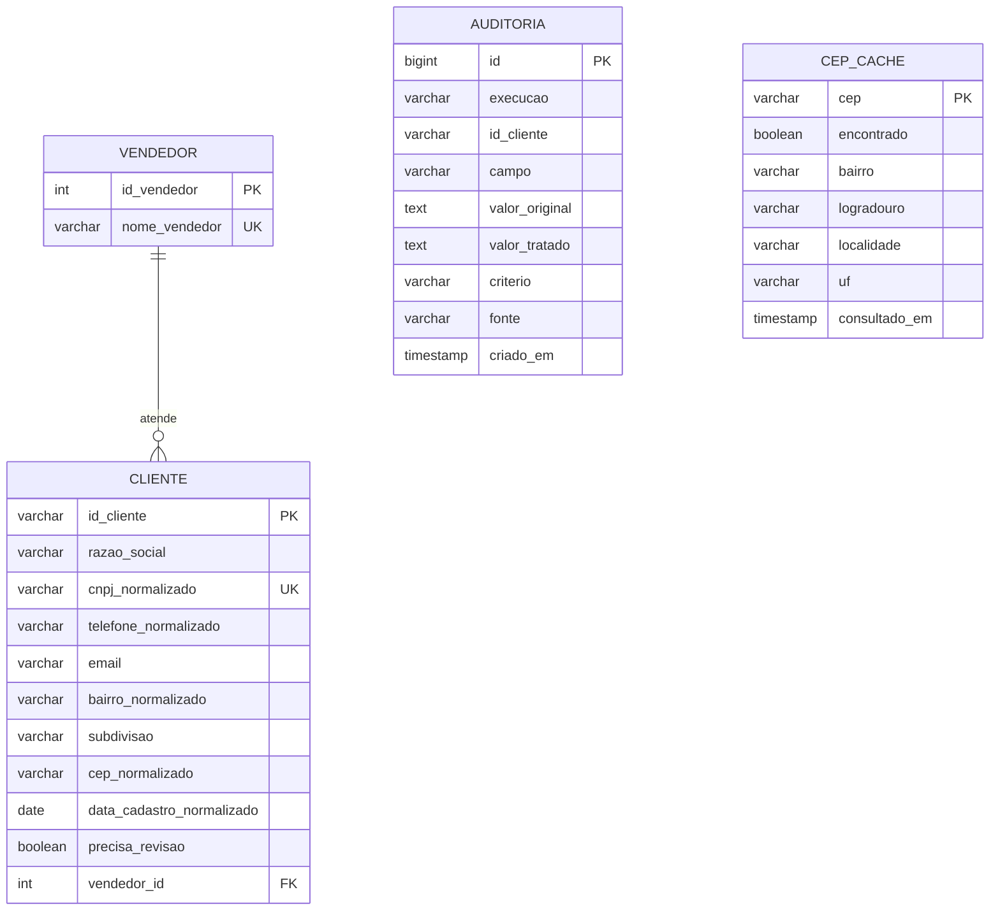

# Guia de construção: Desafio Primora com Python, Django e DRF

Este guia ensina, passo a passo, a construir as duas partes do desafio da Primora descritas em `02 - Desafio Primora_Aprimorado.md`:

1. **Parte 1: ETL.** Ler a base de clientes da Distribuidora Vetor (`clientes_distribuidora_vetor.csv`), corrigir as inconsistências, consultar o CEP no ViaCEP e gravar a base limpa num banco SQL, com auditoria de cada decisão.
2. **Parte 2: API REST.** Disponibilizar os dados tratados com Django REST Framework: CRUD de clientes e vendedores, consultas por bairro e por vendedor, login por token e documentação em Redoc.

As duas partes ficam **no mesmo projeto Django**. O ETL é um comando (`python manage.py etl`) que grava nas mesmas tabelas que a API lê. Assim, o modelo de dados é escrito uma vez só.

> **Dados fictícios:** empresas, CNPJs, e-mails e vendedores são inventados. Só os CEPs são reais, para que o ViaCEP responda de verdade.

> **Não existe gabarito.** O `LEIA-ME.pdf` diz que a equipe decide os critérios de limpeza. Este guia mostra **uma** solução completa e testada, mas toda regra de decisão está marcada com o quadro **Decisão da equipe**. Discutam, mudem se quiserem e justifiquem: a "qualidade da decisão" vale nota.

---

## Sumário

1. [O que vamos construir](#1-o-que-vamos-construir)
2. [Pré-requisitos](#2-pré-requisitos)
3. [Etapa 0: explorar os dados antes de programar](#3-etapa-0-explorar-os-dados-antes-de-programar)
4. [Etapa 1: criar o ambiente e o projeto](#4-etapa-1-criar-o-ambiente-e-o-projeto)
5. [Etapa 2: configurar o Django](#5-etapa-2-configurar-o-django)
6. [Etapa 3: modelar o banco](#6-etapa-3-modelar-o-banco)
7. [Etapa 4: normalizar os campos simples](#7-etapa-4-normalizar-os-campos-simples)
8. [Etapa 5: normalizar bairros](#8-etapa-5-normalizar-bairros)
9. [Etapa 6: consultar o CEP com cache](#9-etapa-6-consultar-o-cep-com-cache)
10. [Etapa 7: montar o pipeline de ETL](#10-etapa-7-montar-o-pipeline-de-etl)
11. [Etapa 8: testes do ETL com mocks](#11-etapa-8-testes-do-etl-com-mocks)
12. [Etapa 9: painel administrativo](#12-etapa-9-painel-administrativo)
13. [Etapa 10: serializers da API](#13-etapa-10-serializers-da-api)
14. [Etapa 11: services e views](#14-etapa-11-services-e-views)
15. [Etapa 12: rotas, token e documentação](#15-etapa-12-rotas-token-e-documentação)
16. [Etapa 13: testar a API](#16-etapa-13-testar-a-api)
17. [Etapa 14: documentação e relatório](#17-etapa-14-documentação-e-relatório)
18. [Etapa 15: Git e entrega](#18-etapa-15-git-e-entrega)
19. [Checklist final](#19-checklist-final)
20. [Problemas comuns](#20-problemas-comuns)
21. [Preparando a apresentação](#21-preparando-a-apresentação)
22. [Extras para se destacar](#22-extras-para-se-destacar)

---

## 1. O que vamos construir

### Como as peças se encaixam

```text
              PARTE 1: ETL  (python manage.py etl)
┌──────────────────────────────────────────────────────────────────┐
│ dados/clientes_distribuidora_vetor.csv                           │
│        │                                                         │
│        ▼  E  etl/extracao.py       lê o CSV, sem mudar nada      │
│        ▼  T  etl/transformacao.py  limpa cada campo              │
│        │       ├── etl/normalizadores.py  CNPJ, telefone, data…  │
│        │       ├── etl/bairros.py         dicionário de bairros  │
│        │       └── etl/viacep.py ───────► ViaCEP (com cache)     │
│        ▼  L  etl/carga.py          grava tudo numa transação     │
└────────┼─────────────────────────────────────────────────────────┘
         ▼
   PostgreSQL:  vendedor ─1:N─ cliente      auditoria      cep_cache
         ▲
┌────────┼─────────────────────────────────────────────────────────┐
│        │       PARTE 2: API  (python manage.py runserver)        │
│  models.py ◄── services.py ◄── views.py ◄── urls.py ◄── cliente  │
│                             serializers.py                       │
└──────────────────────────────────────────────────────────────────┘
```

### Rotas da API

| Rota | Métodos | Quem pode |
|---|---|---|
| `/api/clientes/` | GET, POST | GET: todos. POST: logado |
| `/api/clientes/{id}/` | GET, PUT, PATCH, DELETE | GET: todos. Demais: logado |
| `/api/clientes/bairro/{nome}/` | GET | Todos |
| `/api/clientes/bairros/` | GET (total por bairro) | Todos |
| `/api/clientes/vendedor/{id}/` | GET | Todos |
| `/api/vendedores/` | GET, POST | GET: todos. POST: logado |
| `/api/vendedores/{id}/` | GET, PUT, PATCH, DELETE | GET: todos. Demais: logado |
| `/api/vendedores/{id}/clientes/` | GET | Todos |
| `/api/auth/token/` | POST (usuário e senha) | Todos |
| `/api/docs/` | Documentação Redoc | Todos |

`/api/clientes/bairros/` não está na lista mínima do enunciado, mas atende ao objetivo "rota que **agrupe** clientes por bairro normalizado".

### Estrutura final de pastas

```text
primora-api/
├── .env.example
├── .gitignore
├── README.md
├── manage.py
├── requirements.txt
├── config/
│   ├── __init__.py
│   ├── asgi.py
│   ├── settings.py
│   ├── urls.py
│   └── wsgi.py
├── dados/
│   └── clientes_distribuidora_vetor.csv   ← cópia do arquivo da Primora
├── db/
│   └── schema.sql                         ← gerado na Etapa 3
├── docs/
│   ├── API.md
│   ├── MODELO_DE_DADOS.md                 ← MER + DER
│   ├── REGRAS_DE_NORMALIZACAO.md
│   └── RELATORIO_TRADEOFFS.md
└── distribuidora/
    ├── __init__.py
    ├── admin.py
    ├── apps.py
    ├── models.py
    ├── serializers.py
    ├── services.py
    ├── urls.py
    ├── views.py
    ├── etl/
    │   ├── __init__.py
    │   ├── bairros.py
    │   ├── carga.py
    │   ├── extracao.py
    │   ├── normalizadores.py
    │   ├── transformacao.py
    │   └── viacep.py
    ├── management/
    │   ├── __init__.py
    │   └── commands/
    │       ├── __init__.py
    │       └── etl.py
    ├── migrations/
    │   ├── __init__.py
    │   └── 0001_initial.py                ← gerado pelo Django
    └── tests/
        ├── __init__.py
        ├── test_api.py
        ├── test_bairros.py
        ├── test_etl.py
        ├── test_normalizadores.py
        └── test_viacep.py
```

### Plano de trabalho sugerido (cerca de 1 mês, em grupo)

| Semana | Foco | Seções deste guia |
|---|---|---|
| 1 | Explorar os dados, criar o projeto e o modelo de dados | 1 a 6 |
| 2 | ETL: normalizadores, bairros, ViaCEP, pipeline e testes | 7 a 11 |
| 3 | API: admin, serializers, views, rotas, token, documentação | 12 a 16 |
| 4 | Documentação, relatório de trade-offs, revisão e apresentação | 17 a 21 |

Sugestão de divisão para um grupo de 4 ou 5 pessoas:

| Papel | Responsabilidade principal |
|---|---|
| Dados | Etapa 0, dicionário de bairros, regras de decisão, `REGRAS_DE_NORMALIZACAO.md` |
| ETL | Normalizadores, ViaCEP, pipeline e testes do ETL |
| API | Serializers, views, rotas, permissões e testes da API |
| Banco | PostgreSQL, modelos, migrations, MER/DER, `schema.sql` |
| Comunicação | README, relatório de trade-offs, apresentação |

Todos devem entender o projeto inteiro: na apresentação, qualquer pessoa pode ser chamada a explicar qualquer parte.

---

## 2. Pré-requisitos

- **Python 3.10 ou superior** (o Django 5.2 exige). Confira com `python --version`.
- **PostgreSQL 15 ou superior**, instalado localmente (o desafio cita PostgreSQL). No instalador do Windows, guarde a senha do usuário `postgres` e deixe marcado o **pgAdmin**.
- **Git** e uma conta no GitHub.
- **Internet**, para o ViaCEP durante o ETL. Os testes **não** usam a internet.
- Um editor (VS Code, por exemplo) e o Windows PowerShell.

> **Sem PostgreSQL ainda?** O projeto funciona com SQLite enquanto `POSTGRES_DB` não estiver no `.env` (veja a Etapa 2). Use isso para começar, mas a entrega deve rodar em PostgreSQL.

---

## 3. Etapa 0: explorar os dados antes de programar

Um bom ETL começa olhando os dados. Antes de escrever qualquer regra, abra o CSV e anote **cada tipo de problema**. Esse inventário vira a primeira seção do relatório e da documentação.

### 3.1 Abrindo o CSV

O arquivo usa **ponto e vírgula** como separador e está em UTF-8. Abra-o no VS Code (não no Excel, que pode trocar datas e números sozinho).

Para contar as grafias de bairro com Python, no PowerShell:

```powershell
python -c "import csv, collections; r = csv.DictReader(open('clientes_distribuidora_vetor.csv', encoding='utf-8'), delimiter=';'); print(collections.Counter(l['bairro_informado'] for l in r))"
```

### 3.2 O que você deve encontrar

Confira se a equipe chega às mesmas conclusões:

| Campo | Problema | Exemplos do CSV |
|---|---|---|
| `bairro_informado` | 25 grafias diferentes para 4 bairros | `Águas Claras`, `AGUAS CLARAS`, `aguas claras`, `Águas Claras/DF`, `Aguas Claras - DF` |
| `bairro_informado` | Abreviações | `Vte Pires`, `V. Pires` |
| `bairro_informado` | Subdivisões dos Correios | `Sul (Águas Claras)`, `Águas Claras Norte`, `taguatinga sul`, `Guará II` |
| `bairro_informado` | Vazio | `CLI0047` |
| `cep` | Ausente | 13 registros, incluindo **todos** os do Guará |
| `cep` | Valor de preenchimento | `00000-000` (3 registros) |
| `cep` | Não existe nos Correios | `71900-000`, `72110-800` |
| `cep` × bairro | CEP de outro bairro | `Sul (Aguas Claras)` com CEP de Taguatinga Norte |
| `cnpj` | Com e sem máscara | `84.959.310/3413-16` e `27868011280598` |
| `telefone` | Com DDI, com máscara, sem máscara, fixo e celular | `+55 61 95386-2084`, `(61) 3491-1634`, `61970855700` |
| `data_cadastro` | Quatro formatos | `2022-06-21`, `28/02/2022`, `08-01-2022`, `Dec 24, 2023` |
| `email` | Acentos (inválidos na prática) | `contato@comercialsão.com.br` |
| `email` | Mesmo e-mail em clientes diferentes | `contato@distribuidor.com.br` (4 clientes) |

### 3.3 Consultando o ViaCEP à mão

Para cada CEP distinto, veja o que o ViaCEP responde. No navegador, abra `https://viacep.com.br/ws/71926750/json/`. Resultado real (novembro de 2026):

| CEP | Bairro segundo o ViaCEP | Observação |
|---|---|---|
| 71926-750, 71929-000, 71925-000 | `Sul (Águas Claras)` | |
| 71900-100, 71901-010, 71906-500 | `Norte (Águas Claras)` | |
| 71950-000 | `Areal` | O CSV diz Águas Claras: **conflito** |
| 72006-400, 72006-530 | `Setor Habitacional Vicente Pires` | Nome oficial diferente do popular |
| 72110-010, 72130-010, 72140-010 | `Taguatinga Norte` | 72140-010 aparece num cliente de Águas Claras |
| 71900-000, 72110-800, 00000-000 | `{"erro": "true"}` | CEP inexistente |

Repare em duas coisas:

1. O ViaCEP também usa grafias variadas (`Setor Habitacional Vicente Pires`, `Sul (Águas Claras)`). A mesma função que limpa o bairro digitado vai limpar o bairro do ViaCEP.
2. Para CEP inexistente, o ViaCEP responde **HTTP 200** com `{"erro": "true"}`, e não 404. O código precisa olhar o corpo da resposta.

### 3.4 Decisões que a equipe precisa tomar

Anote as respostas antes de programar. Este guia adota as da segunda coluna:

| Pergunta | Escolha deste guia |
|---|---|
| Qual o nível do "bairro normalizado"? | O bairro principal (`Águas Claras`). A subdivisão (`Norte`, `Sul`, `I`, `II`) fica numa coluna à parte, `subdivisao`. Assim, os relatórios por bairro agrupam certo e a informação fina não se perde. |
| Bairro digitado e bairro do CEP divergem. Quem vence? | O digitado, e o cliente é marcado para revisão manual. Ver seção 8.3. |
| `08-01-2022`: 8 de janeiro ou 1º de agosto? | Dia primeiro (padrão brasileiro). Registrado na auditoria como suposição. |
| E-mail com acento | Remove o acento e registra na auditoria. |
| Telefone e CNPJ | Formato padrão com máscara: `(61) 99999-9999` e `00.000.000/0000-00`. |
| CEP inexistente | Não é gravado. O valor original fica na auditoria. |
| Guará sem nenhum CEP | Usa só o bairro digitado. É um limite conhecido, citado no relatório. |

---

## 4. Etapa 1: criar o ambiente e o projeto

### 4.1 Pasta e ambiente virtual

```powershell
# dentro da pasta "Desafio Empresa Primora"
mkdir primora-api
cd primora-api

python -m venv .venv
.\.venv\Scripts\Activate.ps1
```

Se o PowerShell bloquear a ativação, rode antes `Set-ExecutionPolicy -Scope Process -ExecutionPolicy Bypass`.

### 4.2 Dependências

Crie `requirements.txt`:

```text
Django>=5.2,<6
djangorestframework>=3.15
drf-spectacular>=0.28
psycopg[binary]>=3.2
python-dotenv>=1.0
requests>=2.32
```

```powershell
python -m pip install -r requirements.txt
```

| Biblioteca | Para que serve |
|---|---|
| Django | Framework web: ORM, migrations, admin, comandos |
| djangorestframework | Constrói a API REST (serializers, viewsets, token) |
| drf-spectacular | Gera o schema OpenAPI e as páginas Redoc e Swagger |
| psycopg | Driver de conexão com o PostgreSQL |
| python-dotenv | Lê as configurações do arquivo `.env` |
| requests | Faz as chamadas HTTP ao ViaCEP |

### 4.3 Projeto, app e pastas

```powershell
django-admin startproject config .
python manage.py startapp distribuidora

mkdir dados, db, docs
mkdir distribuidora\etl, distribuidora\management\commands, distribuidora\tests
New-Item distribuidora\etl\__init__.py, distribuidora\management\__init__.py, distribuidora\management\commands\__init__.py, distribuidora\tests\__init__.py -ItemType File
Remove-Item distribuidora\tests.py

Copy-Item ..\clientes_distribuidora_vetor.csv dados\
```

- O **projeto** `config` guarda as configurações gerais.
- O **app** `distribuidora` guarda modelos, ETL e API.
- Apagamos `tests.py` porque os testes vão ficar na **pasta** `tests/`. Com os dois, o Django não sabe qual usar.
- Os arquivos `__init__.py` vazios transformam as pastas em pacotes Python. Sem eles, o comando `etl` e os testes não são encontrados.

### 4.4 Criar o banco no PostgreSQL

Abra o **pgAdmin** (ou o **SQL Shell (psql)**) e rode:

```sql
CREATE DATABASE primora;
```

### 4.5 Arquivos `.env.example`, `.env` e `.gitignore`

`.env.example` vai para o Git e mostra quais configurações existem:

```text
DJANGO_SECRET_KEY=troque-esta-chave-local
DJANGO_DEBUG=1
POSTGRES_DB=primora
POSTGRES_USER=postgres
POSTGRES_PASSWORD=sua-senha-aqui
POSTGRES_HOST=localhost
POSTGRES_PORT=5432
```

```powershell
Copy-Item .env.example .env
```

Edite o `.env` com a senha real do PostgreSQL. Ele **não vai para o Git**.

`.gitignore`:

```text
.venv/
__pycache__/
*.pyc
.env
db.sqlite3
schema.yml
```

---

## 5. Etapa 2: configurar o Django

Substitua todo o conteúdo de `config/settings.py` por:

```python
import os
from pathlib import Path

from dotenv import load_dotenv

BASE_DIR = Path(__file__).resolve().parent.parent
load_dotenv(BASE_DIR / '.env')

SECRET_KEY = os.getenv('DJANGO_SECRET_KEY', 'apenas-para-desenvolvimento-local')
DEBUG = os.getenv('DJANGO_DEBUG', '1') == '1'
ALLOWED_HOSTS = ['localhost', '127.0.0.1']

INSTALLED_APPS = [
    'django.contrib.admin',
    'django.contrib.auth',
    'django.contrib.contenttypes',
    'django.contrib.sessions',
    'django.contrib.messages',
    'django.contrib.staticfiles',
    'rest_framework',
    'rest_framework.authtoken',
    'drf_spectacular',
    'distribuidora',
]

MIDDLEWARE = [
    'django.middleware.security.SecurityMiddleware',
    'django.contrib.sessions.middleware.SessionMiddleware',
    'django.middleware.common.CommonMiddleware',
    'django.middleware.csrf.CsrfViewMiddleware',
    'django.contrib.auth.middleware.AuthenticationMiddleware',
    'django.contrib.messages.middleware.MessageMiddleware',
    'django.middleware.clickjacking.XFrameOptionsMiddleware',
]

ROOT_URLCONF = 'config.urls'

TEMPLATES = [
    {
        'BACKEND': 'django.template.backends.django.DjangoTemplates',
        'DIRS': [],
        'APP_DIRS': True,
        'OPTIONS': {
            'context_processors': [
                'django.template.context_processors.request',
                'django.contrib.auth.context_processors.auth',
                'django.contrib.messages.context_processors.messages',
            ],
        },
    },
]

WSGI_APPLICATION = 'config.wsgi.application'

# PostgreSQL quando POSTGRES_DB estiver no .env; senão, SQLite (útil para testar rápido)
if os.getenv('POSTGRES_DB'):
    DATABASES = {
        'default': {
            'ENGINE': 'django.db.backends.postgresql',
            'NAME': os.getenv('POSTGRES_DB'),
            'USER': os.getenv('POSTGRES_USER', 'postgres'),
            'PASSWORD': os.getenv('POSTGRES_PASSWORD', ''),
            'HOST': os.getenv('POSTGRES_HOST', 'localhost'),
            'PORT': os.getenv('POSTGRES_PORT', '5432'),
        }
    }
else:
    DATABASES = {
        'default': {
            'ENGINE': 'django.db.backends.sqlite3',
            'NAME': BASE_DIR / 'db.sqlite3',
        }
    }

AUTH_PASSWORD_VALIDATORS = [
    {'NAME': 'django.contrib.auth.password_validation.UserAttributeSimilarityValidator'},
    {'NAME': 'django.contrib.auth.password_validation.MinimumLengthValidator'},
    {'NAME': 'django.contrib.auth.password_validation.CommonPasswordValidator'},
    {'NAME': 'django.contrib.auth.password_validation.NumericPasswordValidator'},
]

LANGUAGE_CODE = 'pt-br'
TIME_ZONE = 'America/Sao_Paulo'
USE_I18N = True
USE_TZ = True

STATIC_URL = 'static/'
DEFAULT_AUTO_FIELD = 'django.db.models.BigAutoField'

REST_FRAMEWORK = {
    # Token no cabeçalho "Authorization: Token ..." e sessão (para testar no navegador)
    'DEFAULT_AUTHENTICATION_CLASSES': [
        'rest_framework.authentication.TokenAuthentication',
        'rest_framework.authentication.SessionAuthentication',
    ],
    # Logado: CRUD completo. Não logado: só GET (e HEAD/OPTIONS)
    'DEFAULT_PERMISSION_CLASSES': [
        'rest_framework.permissions.IsAuthenticatedOrReadOnly',
    ],
    'DEFAULT_PAGINATION_CLASS': 'rest_framework.pagination.PageNumberPagination',
    'PAGE_SIZE': 20,
    'DEFAULT_SCHEMA_CLASS': 'drf_spectacular.openapi.AutoSchema',
}

SPECTACULAR_SETTINGS = {
    'TITLE': 'API da Distribuidora Vetor',
    'DESCRIPTION': 'Clientes e vendedores da Distribuidora Vetor, carregados pelo ETL. Dados fictícios.',
    'VERSION': '1.0.0',
}

# Endereço da API de CEP usada no ETL
VIACEP_URL = os.getenv('VIACEP_URL', 'https://viacep.com.br/ws/{cep}/json/')
```

Os pontos que mais importam:

- **`DATABASES`**: com `POSTGRES_DB` no `.env`, usa PostgreSQL. Sem ele, usa SQLite. Nenhuma senha fica no código.
- **`IsAuthenticatedOrReadOnly`**: é exatamente a regra do enunciado. Métodos de leitura (GET, HEAD, OPTIONS) liberados para todos; POST, PUT, PATCH e DELETE só com login. Por ser o padrão, vale para todas as views sem repetir código.
- **`TokenAuthentication`**: o cliente envia `Authorization: Token <chave>`. A `SessionAuthentication` permite testar a API no navegador depois de entrar no admin.
- **`rest_framework.authtoken`** cria a tabela de tokens. Por isso precisa estar em `INSTALLED_APPS` antes do `migrate`.
- **`VIACEP_URL`** fica configurável para trocar de serviço sem mexer no código (por exemplo, BrasilAPI).

`config/urls.py`:

```python
from django.contrib import admin
from django.urls import include, path

urlpatterns = [
    path('admin/', admin.site.urls),
    path('api/', include('distribuidora.urls')),
]
```

O arquivo `distribuidora/urls.py` será criado na Etapa 12. Até lá, o `runserver` não sobe; isso é esperado.

---

## 6. Etapa 3: modelar o banco

### 6.1 MER: o modelo conceitual

O MER descreve **o que** existe no negócio, sem detalhes técnicos:

- **Vendedor** atende **Cliente**. Um vendedor atende muitos clientes; cada cliente tem um vendedor responsável (1:N).
- **Auditoria** registra o que o ETL fez com cada campo de cada cliente. Ela guarda o código do cliente como texto, sem chave estrangeira, para continuar existindo mesmo que o cliente seja apagado depois.
- **CEP em cache** guarda as respostas do ViaCEP. É independente das outras tabelas.

### 6.2 DER: o modelo lógico

O diagrama abaixo usa a sintaxe Mermaid, que o GitHub desenha sozinho. Copie-o para `docs/MODELO_DE_DADOS.md`.



Além dos campos pedidos no enunciado, o cliente tem:

- **`subdivisao`**: guarda `Norte`, `Sul`, `I` ou `II` sem poluir o agrupamento por bairro.
- **`precisa_revisao`**: marca os registros que o ETL não conseguiu resolver sozinho. Facilita o trabalho manual (filtro no admin).

### 6.3 O código (`distribuidora/models.py`)

```python
from django.db import models


class Vendedor(models.Model):
    id_vendedor = models.AutoField(primary_key=True)
    nome_vendedor = models.CharField(max_length=120, unique=True)

    class Meta:
        db_table = 'vendedor'
        ordering = ['nome_vendedor']
        verbose_name_plural = 'vendedores'

    def __str__(self):
        return self.nome_vendedor


class Cliente(models.Model):
    id_cliente = models.CharField(primary_key=True, max_length=10)
    razao_social = models.CharField(max_length=200)
    cnpj_normalizado = models.CharField(max_length=18, unique=True)
    telefone_normalizado = models.CharField(max_length=20, blank=True)
    email = models.EmailField(blank=True)
    bairro_normalizado = models.CharField(max_length=80, db_index=True)
    subdivisao = models.CharField(max_length=20, blank=True)
    cep_normalizado = models.CharField(max_length=9, blank=True)
    data_cadastro_normalizado = models.DateField(null=True, blank=True)
    precisa_revisao = models.BooleanField(default=False)
    vendedor = models.ForeignKey(
        Vendedor, on_delete=models.PROTECT, related_name='clientes'
    )

    class Meta:
        db_table = 'cliente'
        ordering = ['id_cliente']

    def __str__(self):
        return f'{self.id_cliente} - {self.razao_social}'


class Auditoria(models.Model):
    """Uma linha por campo tratado: valor original → valor tratado → critério."""

    execucao = models.CharField(max_length=30, db_index=True)
    id_cliente = models.CharField(max_length=10, db_index=True)
    campo = models.CharField(max_length=40)
    valor_original = models.TextField(blank=True)
    valor_tratado = models.TextField(blank=True)
    criterio = models.CharField(max_length=80)
    fonte = models.CharField(max_length=30)
    criado_em = models.DateTimeField(auto_now_add=True)

    class Meta:
        db_table = 'auditoria'
        ordering = ['-criado_em', 'id_cliente', 'campo']
        verbose_name_plural = 'auditoria'

    def __str__(self):
        return f'{self.id_cliente}.{self.campo}: {self.criterio}'


class CepCache(models.Model):
    """Respostas do ViaCEP guardadas para não consultar o mesmo CEP duas vezes."""

    cep = models.CharField(primary_key=True, max_length=8)
    encontrado = models.BooleanField()
    bairro = models.CharField(max_length=120, blank=True)
    logradouro = models.CharField(max_length=200, blank=True)
    localidade = models.CharField(max_length=120, blank=True)
    uf = models.CharField(max_length=2, blank=True)
    consultado_em = models.DateTimeField(auto_now_add=True)

    class Meta:
        db_table = 'cep_cache'
        verbose_name = 'CEP em cache'
        verbose_name_plural = 'CEPs em cache'

    def __str__(self):
        return f'{self.cep} - {self.bairro or "não encontrado"}'
```

Pontos importantes:

- **`id_cliente`** é a chave primária e mantém o código original (`CLI0001`). Assim, o mesmo cliente é reconhecido em cada execução do ETL e a rota fica `/api/clientes/CLI0001/`.
- **`vendedor`** vira a coluna `vendedor_id` no banco, como pede o enunciado.
- **`on_delete=models.PROTECT`**: o banco recusa apagar um vendedor que ainda tem clientes. A API vai transformar isso numa resposta 409 (Etapa 11).
- **`cnpj_normalizado` com `unique=True`**: só funciona porque todo CNPJ é gravado com a mesma máscara. Sem normalizar, `27868011280598` e `27.868.011/2805-98` passariam como clientes diferentes.
- **`db_table`** dá nomes simples às tabelas (`cliente` em vez de `distribuidora_cliente`), mais fáceis de usar em SQL e nos diagramas.

### 6.4 Migrations

```powershell
python manage.py makemigrations distribuidora
python manage.py migrate
```

- `makemigrations` lê o `models.py` e gera `distribuidora/migrations/0001_initial.py`.
- `migrate` cria todas as tabelas no PostgreSQL: as do desafio, as do Django (usuários, sessões) e a de tokens.

### 6.5 Gerar o `db/schema.sql` para a entrega

```powershell
python manage.py sqlmigrate distribuidora 0001 | Out-File -Encoding utf8 db\schema.sql
```

No PostgreSQL, o resultado é parecido com:

```sql
CREATE TABLE "vendedor" ("id_vendedor" integer NOT NULL PRIMARY KEY GENERATED BY DEFAULT AS IDENTITY,
  "nome_vendedor" varchar(120) NOT NULL UNIQUE);
CREATE TABLE "cliente" ("id_cliente" varchar(10) NOT NULL PRIMARY KEY, "razao_social" varchar(200) NOT NULL,
  "cnpj_normalizado" varchar(18) NOT NULL UNIQUE, ... "vendedor_id" integer NOT NULL);
ALTER TABLE "cliente" ADD CONSTRAINT "cliente_vendedor_id_..._fk_vendedor_id_vendedor"
  FOREIGN KEY ("vendedor_id") REFERENCES "vendedor" ("id_vendedor") DEFERRABLE INITIALLY DEFERRED;
CREATE INDEX "cliente_bairro_normalizado_..." ON "cliente" ("bairro_normalizado");
```

---

## 7. Etapa 4: normalizar os campos simples

Esta é a parte mais importante do ETL. Vamos escrever **funções puras**: recebem um texto e devolvem o valor limpo, sem acessar banco nem internet. Funções puras são fáceis de testar.

Cada função devolve um par **(valor, critério)**. O critério é um código curto (`telefone_ddi_removido`) que vai direto para a tabela de auditoria e explica o que foi feito.

### 7.1 O código (`distribuidora/etl/normalizadores.py`)

```python
"""Regras de limpeza de cada campo. Funções puras: não acessam banco nem internet."""
import re
import unicodedata
from collections import namedtuple
from datetime import date

# Todo normalizador devolve o valor tratado e o critério usado (vai para a auditoria)
Tratado = namedtuple('Tratado', 'valor criterio')

MESES_EN = {
    'jan': 1, 'feb': 2, 'mar': 3, 'apr': 4, 'may': 5, 'jun': 6,
    'jul': 7, 'aug': 8, 'sep': 9, 'oct': 10, 'nov': 11, 'dec': 12,
}


def so_digitos(texto):
    return re.sub(r'\D', '', texto or '')


def remover_acentos(texto):
    decomposto = unicodedata.normalize('NFKD', texto)
    return ''.join(c for c in decomposto if not unicodedata.combining(c))


def normalizar_texto(texto):
    """Minúsculas, sem acentos e com espaços simples: 'ÁGUAS  Claras ' → 'aguas claras'."""
    return re.sub(r'\s+', ' ', remover_acentos(texto or '')).strip().lower()


def normalizar_cnpj(texto):
    digitos = so_digitos(texto)
    if len(digitos) != 14:
        return Tratado(None, 'cnpj_invalido_tamanho')
    formatado = f'{digitos[:2]}.{digitos[2:5]}.{digitos[5:8]}/{digitos[8:12]}-{digitos[12:]}'
    if formatado == (texto or '').strip():
        return Tratado(formatado, 'sem_alteracao')
    return Tratado(formatado, 'cnpj_mascara_aplicada')


def normalizar_telefone(texto):
    digitos = so_digitos(texto)
    criterio = 'telefone_mascara_aplicada'
    if len(digitos) in (12, 13) and digitos.startswith('55'):
        digitos = digitos[2:]
        criterio = 'telefone_ddi_removido'
    if len(digitos) == 11:  # celular: DDD + 9 dígitos
        formatado = f'({digitos[:2]}) {digitos[2:7]}-{digitos[7:]}'
    elif len(digitos) == 10:  # fixo: DDD + 8 dígitos
        formatado = f'({digitos[:2]}) {digitos[2:6]}-{digitos[6:]}'
    else:
        return Tratado(None, 'telefone_invalido')
    if formatado == (texto or '').strip():
        criterio = 'sem_alteracao'
    return Tratado(formatado, criterio)


def normalizar_email(texto):
    email = (texto or '').strip().lower()
    if not email:
        return Tratado(None, 'email_ausente')
    sem_acento = remover_acentos(email)
    if sem_acento != email:
        return Tratado(sem_acento, 'email_acentos_removidos')
    return Tratado(email, 'sem_alteracao' if email == texto else 'email_minusculas')


def normalizar_data(texto):
    t = (texto or '').strip()
    if m := re.fullmatch(r'(\d{4})-(\d{2})-(\d{2})', t):
        ano, mes, dia = int(m[1]), int(m[2]), int(m[3])
        criterio = 'sem_alteracao'
    elif m := re.fullmatch(r'(\d{2})/(\d{2})/(\d{4})', t):
        dia, mes, ano = int(m[1]), int(m[2]), int(m[3])
        criterio = 'data_br_barra'
    elif m := re.fullmatch(r'(\d{2})-(\d{2})-(\d{4})', t):
        dia, mes, ano = int(m[1]), int(m[2]), int(m[3])
        criterio = 'data_br_hifen_dia_primeiro'
    elif m := re.fullmatch(r'([A-Za-z]{3})\s+(\d{1,2}),\s*(\d{4})', t):
        mes = MESES_EN.get(m[1].lower())
        dia, ano = int(m[2]), int(m[3])
        criterio = 'data_texto_ingles'
        if mes is None:
            return Tratado(None, 'data_mes_desconhecido')
    else:
        return Tratado(None, 'data_formato_desconhecido')
    try:
        return Tratado(date(ano, mes, dia), criterio)
    except ValueError:  # ex.: 31/02/2024
        return Tratado(None, 'data_inexistente')


def normalizar_cep(texto):
    """Devolve só os 8 dígitos do CEP (ou None, com o motivo)."""
    if not (texto or '').strip():
        return Tratado(None, 'cep_ausente')
    digitos = so_digitos(texto)
    if len(digitos) != 8:
        return Tratado(None, 'cep_formato_invalido')
    if digitos == '00000000':
        return Tratado(None, 'cep_zerado')
    return Tratado(digitos, 'cep_formato_valido')


def formatar_cep(digitos):
    return f'{digitos[:5]}-{digitos[5:]}'


def normalizar_nome(texto):
    nome = re.sub(r'\s+', ' ', texto or '').strip()
    return Tratado(nome, 'sem_alteracao' if nome == texto else 'espacos_ajustados')
```

### 7.2 Entendendo cada regra

| Função | Regra | Por quê |
|---|---|---|
| `so_digitos` | Remove tudo que não é número | Ponto de partida comum de CNPJ, telefone e CEP: ignora máscara, espaços e `+` |
| `remover_acentos` | `NFKD` separa a letra do acento; depois descartamos o acento | `"Á"` vira `"A"` + `"´"`; ficamos só com `"A"` |
| `normalizar_cnpj` | 14 dígitos → `00.000.000/0000-00` | Um formato só permite comparar e impedir CNPJ duplicado |
| `normalizar_telefone` | Tira o DDI `55` e aplica a máscara de fixo (10 dígitos) ou celular (11) | `+55 61 95386-2084` e `61953862084` são o mesmo número |
| `normalizar_data` | Reconhece 4 formatos por expressão regular | Evitamos `strptime` com `%b` porque o nome do mês depende do idioma do computador |
| `normalizar_cep` | 8 dígitos, diferente de `00000000` | `00000-000` é "valor de preenchimento", não um CEP |
| `normalizar_email` | Minúsculas e sem acento | Os e-mails foram gerados a partir do nome da empresa; acentos em endereço de e-mail quase sempre são erro de digitação |

Algumas sintaxes que podem ser novas:

- **`namedtuple`** cria uma tupla com nomes: `Tratado('x', 'y').valor` é `'x'`. Como continua sendo tupla, dá para comparar direto nos testes: `tratado == ('x', 'y')`.
- **`if m := re.fullmatch(...)`** (operador "morsa", Python 3.8+) guarda o resultado e testa ao mesmo tempo. `m[1]` é o primeiro grupo entre parênteses.
- **`re.fullmatch`** exige que o padrão case com o texto **inteiro**. `re.match` aceitaria `2022-06-21xyz`.

> **Decisão da equipe: CNPJ inválido.** Todos os CNPJs do arquivo são fictícios e **nenhum** tem dígitos verificadores válidos. Por isso, este guia só confere o tamanho. Validar os dígitos é um extra (seção 22): se fizerem, não descartem o cliente, só marquem para revisão.

> **Decisão da equipe: `08-01-2022`.** O formato é ambíguo. Adotamos dia primeiro porque todos os outros formatos numéricos do arquivo seguem o padrão brasileiro (`28/02/2022`). O critério `data_br_hifen_dia_primeiro` deixa essa suposição visível na auditoria.

---

## 8. Etapa 5: normalizar bairros

Este é o **campo central do desafio**. A ideia tem três passos:

1. **Limpeza determinística:** caixa, acentos, espaços, sufixo `- DF`, abreviações.
2. **Separar a subdivisão:** `Sul (Águas Claras)` e `Águas Claras Sul` viram bairro `Águas Claras` + subdivisão `Sul`.
3. **Dicionário de correspondência:** o texto limpo é procurado num dicionário `variante → nome canônico`. O que não estiver no dicionário **não é adivinhado**.

### 8.1 O código (`distribuidora/etl/bairros.py`)

```python
"""Canonização de bairros e regra de decisão entre o bairro digitado e o do CEP."""
import re
from collections import namedtuple

from .normalizadores import normalizar_texto

Bairro = namedtuple('Bairro', 'nome subdivisao')
Decisao = namedtuple('Decisao', 'nome subdivisao criterio precisa_revisao')

BAIRRO_DESCONHECIDO = 'Não identificado'

# Dicionário de correspondência: texto normalizado → nome canônico.
# Cresce conforme aparecem variantes novas (inclusive as que o ViaCEP devolve).
BAIRROS_CANONICOS = {
    'aguas claras': 'Águas Claras',
    'taguatinga': 'Taguatinga',
    'vicente pires': 'Vicente Pires',
    'setor habitacional vicente pires': 'Vicente Pires',
    'guara': 'Guará',
    'areal': 'Areal',
}

SUBDIVISOES = {'norte': 'Norte', 'sul': 'Sul', 'i': 'I', 'ii': 'II'}

ABREVIACOES = [
    (r'^vte\.?\s+', 'vicente '),  # "Vte Pires"
    (r'^v\.\s*', 'vicente '),     # "V. Pires"
]


def canonizar_bairro(texto):
    """'Sul (Águas Claras)' → Bairro('Águas Claras', 'Sul'). Devolve None se não reconhecer."""
    t = normalizar_texto(texto)
    if not t:
        return None

    t = re.sub(r'\s*[-/]\s*df$', '', t)  # "Taguatinga - DF", "Águas Claras/DF"
    for padrao, troca in ABREVIACOES:
        t = re.sub(padrao, troca, t)

    subdivisao = ''
    if m := re.fullmatch(r'(\w+)\s*\((.+)\)', t):  # "norte (aguas claras)"
        subdivisao, t = m[1], m[2].strip()
    elif m := re.fullmatch(r'(.+?)\s+(norte|sul|i|ii)', t):  # "taguatinga sul", "guara ii"
        t, subdivisao = m[1], m[2]

    nome = BAIRROS_CANONICOS.get(t)
    if nome is None:
        return None
    return Bairro(nome, SUBDIVISOES.get(subdivisao, ''))


def decidir_bairro(informado, do_cep):
    """Escolhe o bairro final quando há duas fontes (digitado e ViaCEP)."""
    if informado and do_cep:
        if informado.nome != do_cep.nome:
            return Decisao(informado.nome, informado.subdivisao,
                           'conflito_bairro_x_cep_mantido_informado', True)
        if informado.subdivisao and informado.subdivisao != do_cep.subdivisao:
            return Decisao(do_cep.nome, do_cep.subdivisao, 'subdivisao_corrigida_pelo_cep', False)
        return Decisao(do_cep.nome, do_cep.subdivisao, 'bairro_confirmado_pelo_cep', False)
    if informado:
        return Decisao(informado.nome, informado.subdivisao, 'bairro_informado_sem_cep_confirmado', False)
    if do_cep:
        return Decisao(do_cep.nome, do_cep.subdivisao, 'bairro_preenchido_pelo_cep', False)
    return Decisao(BAIRRO_DESCONHECIDO, '', 'sem_bairro_e_sem_cep', True)
```

### 8.2 Acompanhando a canonização

| Texto original | Depois de limpar | Depois de separar | Resultado |
|---|---|---|---|
| `Aguas Claras - DF` | `aguas claras` | `aguas claras` | Águas Claras |
| `Sul (Águas Claras)` | `sul (aguas claras)` | `aguas claras` + `sul` | Águas Claras / Sul |
| `Águas Claras Norte` | `aguas claras norte` | `aguas claras` + `norte` | Águas Claras / Norte |
| `Vte Pires` | `vicente pires` | `vicente pires` | Vicente Pires |
| `Guará II` | `guara ii` | `guara` + `ii` | Guará / II |
| `Setor Habitacional Vicente Pires` (ViaCEP) | igual, minúsculo | igual | Vicente Pires |
| `Bairro Inventado` | `bairro inventado` | igual | `None` (não reconhecido) |

Por que o dicionário em vez de "achar o mais parecido" (similaridade de texto)? Porque é **explicável**: para qualquer cliente, dá para mostrar a linha exata do dicionário que produziu o resultado. Comparação por similaridade pode juntar bairros diferentes com nomes parecidos, e isso é difícil de defender diante de uma audiência não técnica.

### 8.3 A regra de decisão entre as duas fontes

| Bairro digitado | Bairro do CEP (ViaCEP) | Resultado | Revisar? |
|---|---|---|---|
| Reconhecido | Mesmo bairro e mesma subdivisão (ou digitado sem subdivisão) | Bairro e subdivisão do CEP: `bairro_confirmado_pelo_cep` | Não |
| Reconhecido | Mesmo bairro, subdivisão diferente | Subdivisão do CEP: `subdivisao_corrigida_pelo_cep` | Não |
| Reconhecido | **Outro bairro** | Mantém o digitado: `conflito_bairro_x_cep_mantido_informado` | **Sim** |
| Reconhecido | Sem CEP válido | Digitado: `bairro_informado_sem_cep_confirmado` | Não |
| Vazio ou fora do dicionário | Reconhecido | Do CEP: `bairro_preenchido_pelo_cep` | Não (sim, se o texto era desconhecido) |
| Vazio | Sem CEP válido | `Não identificado`: `sem_bairro_e_sem_cep` | **Sim** |

> **Decisão da equipe: quem vence no conflito?** Este guia mantém o bairro digitado porque: (1) quem cadastrou estava com o cliente e escreveu o bairro de propósito; (2) o mesmo CEP `72140-010` aparece em clientes de Águas Claras e de Taguatinga, sinal de CEP copiado de outro cadastro. Mas **não resolvemos sozinhos**: o registro fica com `precisa_revisao = True`. Uma equipe pode escolher o contrário ("o CEP é a fonte oficial") e também estará certa, **desde que justifique** no relatório. O importante é a regra ser a mesma para todos os registros.

> **Decisão da equipe: subdivisão.** Quando o bairro bate mas a subdivisão não (`taguatinga sul` com CEP de Taguatinga Norte), usamos a do CEP sem pedir revisão: o agrupamento por bairro não muda. Se a equipe achar que isso também merece revisão, basta trocar o `False` por `True`.

---

## 9. Etapa 6: consultar o CEP com cache

O enunciado sugere o ViaCEP **com cache local**. O cache evita repetir chamadas, deixa o ETL mais rápido e permite rodar de novo mesmo sem internet (para CEPs já consultados).

Guardamos o cache numa tabela (`cep_cache`), e não num arquivo, para poder vê-lo no admin.

`distribuidora/etl/viacep.py`:

```python
"""Consulta ao ViaCEP com cache no banco (tabela cep_cache)."""
import logging

import requests
from django.conf import settings

from ..models import CepCache

logger = logging.getLogger(__name__)


def buscar_no_viacep(cep):
    """Chama a API. Devolve o dicionário de resposta, ou None se o CEP não existe.

    Lança requests.RequestException se a API estiver fora do ar.
    """
    resposta = requests.get(settings.VIACEP_URL.format(cep=cep), timeout=5)
    resposta.raise_for_status()
    dados = resposta.json()
    if dados.get('erro'):  # o ViaCEP responde 200 com {"erro": "true"} para CEP inexistente
        return None
    return dados


def consultar_cep(cep):
    """Devolve o CepCache do CEP, consultando a API só na primeira vez.

    Devolve None se a API falhar (nada é guardado, para tentar de novo na próxima execução).
    """
    cache = CepCache.objects.filter(cep=cep).first()
    if cache is not None:
        return cache
    try:
        dados = buscar_no_viacep(cep)
    except requests.RequestException:
        logger.warning('ViaCEP indisponível para o CEP %s', cep)
        return None
    dados = dados or {}
    return CepCache.objects.create(
        cep=cep,
        encontrado=bool(dados),
        bairro=dados.get('bairro', ''),
        logradouro=dados.get('logradouro', ''),
        localidade=dados.get('localidade', ''),
        uf=dados.get('uf', ''),
    )
```

Três situações diferentes, três respostas diferentes:

| Situação | O que `consultar_cep` devolve | Vai para o cache? |
|---|---|---|
| CEP existe | `CepCache` com `encontrado=True` e o bairro | Sim |
| CEP não existe (`{"erro": "true"}`) | `CepCache` com `encontrado=False` | Sim: não adianta perguntar de novo |
| Internet ou API fora do ar | `None` | **Não**: na próxima execução, tenta de novo |

- **`timeout=5`**: sem ele, uma API travada deixaria o ETL esperando para sempre.
- **`raise_for_status()`** transforma respostas 500 ou 429 (excesso de pedidos) em exceção, tratada como "API fora do ar".
- Separar `buscar_no_viacep` (só a chamada HTTP) de `consultar_cep` (cache) facilita os testes: dá para trocar só a chamada HTTP por uma versão falsa.

---

## 10. Etapa 7: montar o pipeline de ETL

### 10.1 Extração (`distribuidora/etl/extracao.py`)

```python
"""E do ETL: lê o CSV original sem alterar nada."""
import csv

COLUNAS_ESPERADAS = {
    'id_cliente', 'razao_social', 'cnpj', 'telefone', 'email', 'bairro_informado',
    'cep', 'cidade', 'uf', 'data_cadastro', 'vendedor_responsavel',
}


def ler_csv(caminho):
    """Devolve uma lista de dicionários, um por linha, com todos os valores como texto."""
    with open(caminho, encoding='utf-8-sig', newline='') as arquivo:
        leitor = csv.DictReader(arquivo, delimiter=';')
        faltando = COLUNAS_ESPERADAS - set(leitor.fieldnames or [])
        if faltando:
            raise ValueError(f'Colunas ausentes no CSV: {sorted(faltando)}')
        return [dict(linha) for linha in leitor]
```

- **`csv` da biblioteca padrão** em vez de pandas: para 47 linhas, não precisamos de mais uma dependência, e tudo chega como **texto**. O pandas tentaria converter colunas sozinho (CNPJ sem máscara viraria número e perderia zeros à esquerda, como em `04.711.671/9022-94`).
- **`utf-8-sig`** aceita arquivos salvos com BOM (comum quando alguém abre e salva no Excel).
- A checagem de colunas faz o ETL **falhar cedo e com mensagem clara** se receber o arquivo errado.

### 10.2 Transformação (`distribuidora/etl/transformacao.py`)

Aqui juntamos tudo: cada linha do CSV vira um cliente limpo e uma lista de linhas de auditoria, **uma por campo**.

```python
"""T do ETL: transforma uma linha do CSV num cliente limpo + linhas de auditoria."""
from .bairros import canonizar_bairro, decidir_bairro
from .normalizadores import (
    Tratado, formatar_cep, normalizar_cep, normalizar_cnpj, normalizar_data,
    normalizar_email, normalizar_nome, normalizar_telefone,
)
from .viacep import consultar_cep


def tratar_cep(texto, consultar):
    """Devolve (Tratado do CEP, Bairro segundo o ViaCEP ou None, fonte)."""
    limpo = normalizar_cep(texto)
    if limpo.valor is None:
        return limpo, None, 'regra_local'
    consulta = consultar(limpo.valor)
    if consulta is None:
        return Tratado(formatar_cep(limpo.valor), 'cep_nao_verificado_api_indisponivel'), None, 'regra_local'
    if not consulta.encontrado:
        return Tratado(None, 'cep_inexistente_no_viacep'), None, 'viacep'
    return Tratado(formatar_cep(limpo.valor), 'cep_confirmado_viacep'), canonizar_bairro(consulta.bairro), 'viacep'


def transformar(linha, consultar=consultar_cep):
    """Recebe uma linha do CSV e devolve um dicionário com o cliente e a auditoria.

    `consultar` é a função que busca o CEP; nos testes, passamos uma versão falsa.
    """
    id_cliente = linha['id_cliente'].strip()
    auditoria = []

    def registrar(campo, original, tratado, fonte='regra_local'):
        auditoria.append({
            'id_cliente': id_cliente,
            'campo': campo,
            'valor_original': original or '',
            'valor_tratado': '' if tratado.valor is None else str(tratado.valor),
            'criterio': tratado.criterio,
            'fonte': fonte,
        })
        return tratado.valor

    razao_social = registrar('razao_social', linha['razao_social'], normalizar_nome(linha['razao_social']))
    cnpj = registrar('cnpj', linha['cnpj'], normalizar_cnpj(linha['cnpj']))
    telefone = registrar('telefone', linha['telefone'], normalizar_telefone(linha['telefone']))
    email = registrar('email', linha['email'], normalizar_email(linha['email']))
    data = registrar('data_cadastro', linha['data_cadastro'], normalizar_data(linha['data_cadastro']))
    vendedor = registrar('vendedor', linha['vendedor_responsavel'],
                         normalizar_nome(linha['vendedor_responsavel']))

    tratado_cep, bairro_do_cep, fonte_cep = tratar_cep(linha['cep'], consultar)
    cep = registrar('cep', linha['cep'], tratado_cep, fonte_cep)

    texto_bairro = linha['bairro_informado']
    informado = canonizar_bairro(texto_bairro)
    decisao = decidir_bairro(informado, bairro_do_cep)
    fonte_bairro = 'dicionario+viacep' if bairro_do_cep else 'dicionario'
    registrar('bairro', texto_bairro, Tratado(decisao.nome, decisao.criterio), fonte_bairro)

    precisa_revisao = decisao.precisa_revisao or cnpj is None or data is None
    if texto_bairro.strip() and informado is None:
        registrar('bairro', texto_bairro, Tratado(decisao.nome, 'bairro_fora_do_dicionario'))
        precisa_revisao = True

    cliente = {
        'id_cliente': id_cliente,
        'razao_social': razao_social,
        'cnpj_normalizado': cnpj or '',
        'telefone_normalizado': telefone or '',
        'email': email or '',
        'bairro_normalizado': decisao.nome,
        'subdivisao': decisao.subdivisao,
        'cep_normalizado': cep or '',
        'data_cadastro_normalizado': data,
        'precisa_revisao': precisa_revisao,
    }
    return {'cliente': cliente, 'vendedor': vendedor, 'auditoria': auditoria}
```

- **`registrar`** é uma função dentro da função. Ela anota a auditoria e devolve o valor limpo, numa linha só por campo.
- **Toda** decisão vira linha de auditoria, inclusive `sem_alteracao`. Assim, para qualquer cliente, dá para explicar cada campo (critério "rastreabilidade").
- **`fonte`** diz de onde veio a decisão: `regra_local`, `dicionario`, `viacep` ou `dicionario+viacep`.
- **`consultar=consultar_cep`** é um parâmetro com valor padrão. No uso normal, chama o ViaCEP; num teste, podemos passar outra função.

### 10.3 Carga (`distribuidora/etl/carga.py`)

```python
"""L do ETL: grava clientes, vendedores e auditoria numa única transação."""
from django.db import transaction

from ..models import Auditoria, Cliente, Vendedor


@transaction.atomic
def carregar(resultados, execucao):
    """Grava tudo ou nada. Rodar de novo atualiza os clientes, sem duplicar."""
    for resultado in resultados:
        vendedor, _ = Vendedor.objects.get_or_create(nome_vendedor=resultado['vendedor'])
        dados = dict(resultado['cliente'])
        id_cliente = dados.pop('id_cliente')
        Cliente.objects.update_or_create(
            id_cliente=id_cliente, defaults={**dados, 'vendedor': vendedor}
        )
        Auditoria.objects.bulk_create(
            Auditoria(execucao=execucao, **linha) for linha in resultado['auditoria']
        )
```

| Técnica | Efeito |
|---|---|
| `@transaction.atomic` | Se qualquer linha falhar, nada é gravado. O banco nunca fica "pela metade". |
| `get_or_create` | Cria o vendedor só se o nome ainda não existir. A tabela `vendedor` nasce dos nomes do CSV. |
| `update_or_create` | Se o cliente já existe, atualiza; senão, cria. Rodar o ETL duas vezes não duplica clientes (**idempotência**). |
| `execucao` | Cada execução tem um código (data e hora). A auditoria guarda o histórico de todas. |

### 10.4 O comando (`distribuidora/management/commands/etl.py`)

```python
from collections import Counter

from django.conf import settings
from django.core.management.base import BaseCommand
from django.utils import timezone

from distribuidora.etl.carga import carregar
from distribuidora.etl.extracao import ler_csv
from distribuidora.etl.transformacao import transformar

CSV_PADRAO = settings.BASE_DIR / 'dados' / 'clientes_distribuidora_vetor.csv'


class Command(BaseCommand):
    help = 'Executa o ETL: lê o CSV, normaliza os dados e grava no banco com auditoria.'

    def add_arguments(self, parser):
        parser.add_argument('--arquivo', default=str(CSV_PADRAO), help='Caminho do CSV de clientes.')

    def handle(self, *args, **options):
        execucao = timezone.now().strftime('%Y%m%d-%H%M%S')

        linhas = ler_csv(options['arquivo'])                    # E
        self.stdout.write(f'Extraídas {len(linhas)} linhas.')

        resultados = [transformar(linha) for linha in linhas]   # T

        carregar(resultados, execucao)                          # L

        revisar = [r['cliente']['id_cliente'] for r in resultados if r['cliente']['precisa_revisao']]
        bairros = Counter(r['cliente']['bairro_normalizado'] for r in resultados)
        self.stdout.write(f'Execução {execucao}: {len(resultados)} clientes carregados.')
        for bairro, total in bairros.most_common():
            self.stdout.write(f'  {bairro}: {total}')
        self.stdout.write(self.style.WARNING(f'Precisam de revisão manual: {", ".join(revisar) or "nenhum"}'))
```

As três letras do ETL aparecem em três linhas do `handle`, cada uma num módulo próprio. Isso atende ao entregável "etapas claras de extração, transformação e carga".

### 10.5 Rodar

```powershell
python manage.py etl
```

Saída real com o CSV da Primora:

```text
Extraídas 47 linhas.
Execução 20261105-165205: 47 clientes carregados.
  Águas Claras: 22
  Taguatinga: 10
  Vicente Pires: 8
  Guará: 6
  Não identificado: 1
Precisam de revisão manual: CLI0002, CLI0010, CLI0012, CLI0032, CLI0047
```

**25 grafias diferentes viraram 4 bairros.** Rode de novo: o total continua 47 clientes, e a segunda execução é mais rápida porque os CEPs vêm do cache.

Os 5 casos para revisão manual são exatamente as ambiguidades que o `LEIA-ME` diz ter inserido de propósito:

| Cliente | Bairro digitado | CEP | ViaCEP diz | Motivo |
|---|---|---|---|---|
| CLI0002 | `Sul (Aguas Claras)` | 72140-010 | Taguatinga Norte | Conflito bairro × CEP |
| CLI0010 | `Águas Claras/DF` | 71950-000 | Areal | Conflito bairro × CEP |
| CLI0012 | `Aguas Claras - DF` | 71950-000 | Areal | Conflito bairro × CEP |
| CLI0032 | `aguas claras` | 71950-000 | Areal | Conflito bairro × CEP |
| CLI0047 | (vazio) | (vazio) | | Sem nenhuma informação de bairro |

### 10.6 Números para o relatório

Para contar o que o ETL fez na última execução:

```powershell
python manage.py shell
```

```python
from collections import Counter
from distribuidora.models import Auditoria
ultima = Auditoria.objects.order_by('-execucao').values_list('execucao', flat=True).first()
linhas = Auditoria.objects.filter(execucao=ultima)
for (campo, criterio), total in sorted(Counter(linhas.values_list('campo', 'criterio')).items()):
    print(f'{campo:15} {criterio:42} {total}')
```

Resultado esperado (resumido):

| Campo | Critério | Registros |
|---|---|---|
| bairro | `bairro_confirmado_pelo_cep` | 22 |
| bairro | `bairro_informado_sem_cep_confirmado` | 18 |
| bairro | `conflito_bairro_x_cep_mantido_informado` | 4 |
| bairro | `subdivisao_corrigida_pelo_cep` | 2 |
| bairro | `sem_bairro_e_sem_cep` | 1 |
| cep | `cep_confirmado_viacep` | 28 |
| cep | `cep_ausente` | 13 |
| cep | `cep_zerado` | 3 |
| cep | `cep_inexistente_no_viacep` | 3 |
| telefone | `telefone_ddi_removido` / `telefone_mascara_aplicada` | 12 / 13 |
| cnpj | `cnpj_mascara_aplicada` | 9 |
| email | `email_acentos_removidos` | 10 |
| data_cadastro | `data_br_barra` / `data_br_hifen_dia_primeiro` / `data_texto_ingles` | 9 / 7 / 8 |

Esses números são a "cobertura do tratamento" e entram no relatório de trade-offs.

---

## 11. Etapa 8: testes do ETL com mocks

O desafio pede testes da lógica de normalização e diz que **chamadas externas devem ser simuladas**. Um teste que depende do ViaCEP falha quando a internet cai, fica lento e consulta a API sem necessidade.

A ferramenta é o **`unittest.mock.patch`**: durante o teste, ele troca uma função real por uma falsa que nós controlamos.

### 11.1 Normalizadores (`distribuidora/tests/test_normalizadores.py`)

`SimpleTestCase` é a classe de teste do Django que **não** usa banco: perfeita para funções puras.

```python
from datetime import date

from django.test import SimpleTestCase

from distribuidora.etl.normalizadores import (
    normalizar_cep, normalizar_cnpj, normalizar_data, normalizar_email,
    normalizar_telefone, normalizar_texto,
)


class NormalizarTextoTests(SimpleTestCase):
    def test_remove_acentos_caixa_e_espacos(self):
        self.assertEqual(normalizar_texto('  ÁGUAS   Claras '), 'aguas claras')


class CnpjTests(SimpleTestCase):
    def test_aplica_mascara_em_cnpj_so_com_digitos(self):
        self.assertEqual(normalizar_cnpj('27868011280598').valor, '27.868.011/2805-98')

    def test_mantem_cnpj_ja_formatado(self):
        tratado = normalizar_cnpj('84.959.310/3413-16')
        self.assertEqual(tratado, ('84.959.310/3413-16', 'sem_alteracao'))

    def test_aceita_espacos(self):
        self.assertEqual(normalizar_cnpj(' 27 868 011 2805 98 ').valor, '27.868.011/2805-98')

    def test_recusa_tamanho_errado(self):
        self.assertIsNone(normalizar_cnpj('123').valor)


class TelefoneTests(SimpleTestCase):
    def test_formatos_do_csv(self):
        casos = {
            '61970855700': '(61) 97085-5700',
            '+55 61 95386-2084': '(61) 95386-2084',
            '(61) 98433-1053': '(61) 98433-1053',
            '61 3970-2193': '(61) 3970-2193',
            '(61) 3491-1634': '(61) 3491-1634',
        }
        for entrada, esperado in casos.items():
            with self.subTest(entrada=entrada):
                self.assertEqual(normalizar_telefone(entrada).valor, esperado)

    def test_registra_remocao_do_ddi(self):
        self.assertEqual(normalizar_telefone('+55 61 95386-2084').criterio, 'telefone_ddi_removido')

    def test_recusa_numero_curto(self):
        self.assertIsNone(normalizar_telefone('3491-1634').valor)


class DataTests(SimpleTestCase):
    def test_formatos_do_csv(self):
        casos = {
            '2022-06-21': date(2022, 6, 21),
            '28/02/2022': date(2022, 2, 28),
            '08-01-2022': date(2022, 1, 8),
            'Dec 24, 2023': date(2023, 12, 24),
            'jul 21, 2022': date(2022, 7, 21),
            'Apr 3, 2025': date(2025, 4, 3),
        }
        for entrada, esperado in casos.items():
            with self.subTest(entrada=entrada):
                self.assertEqual(normalizar_data(entrada).valor, esperado)

    def test_data_inexistente(self):
        self.assertEqual(normalizar_data('31/02/2024'), (None, 'data_inexistente'))

    def test_formato_desconhecido(self):
        self.assertIsNone(normalizar_data('ontem').valor)


class CepTests(SimpleTestCase):
    def test_cep_valido(self):
        self.assertEqual(normalizar_cep('71926-750').valor, '71926750')

    def test_cep_ausente_zerado_e_invalido(self):
        self.assertEqual(normalizar_cep('').criterio, 'cep_ausente')
        self.assertEqual(normalizar_cep('00000-000').criterio, 'cep_zerado')
        self.assertEqual(normalizar_cep('7192').criterio, 'cep_formato_invalido')


class EmailTests(SimpleTestCase):
    def test_remove_acentos(self):
        tratado = normalizar_email('contato@comercialsão.com.br')
        self.assertEqual(tratado, ('contato@comercialsao.com.br', 'email_acentos_removidos'))
```

**`self.subTest`** roda vários casos dentro de um teste. Se um falhar, o relatório mostra **qual** entrada falhou, e os outros casos continuam sendo testados.

### 11.2 Bairros (`distribuidora/tests/test_bairros.py`)

```python
from django.test import SimpleTestCase

from distribuidora.etl.bairros import Bairro, canonizar_bairro, decidir_bairro


class CanonizarBairroTests(SimpleTestCase):
    def test_variantes_do_csv(self):
        casos = {
            'Águas Claras': ('Águas Claras', ''),
            'AGUAS CLARAS': ('Águas Claras', ''),
            'Aguas Claras - DF': ('Águas Claras', ''),
            'Águas Claras/DF': ('Águas Claras', ''),
            'Sul (Águas Claras)': ('Águas Claras', 'Sul'),
            'Norte (Aguas Claras)': ('Águas Claras', 'Norte'),
            'Águas Claras Norte': ('Águas Claras', 'Norte'),
            'Taguatinga/DF': ('Taguatinga', ''),
            'taguatinga sul': ('Taguatinga', 'Sul'),
            'Vte Pires': ('Vicente Pires', ''),
            'V. Pires': ('Vicente Pires', ''),
            'Vicente Pires - DF': ('Vicente Pires', ''),
            'guara - df': ('Guará', ''),
            'Guará II': ('Guará', 'II'),
            'Guará I': ('Guará', 'I'),
        }
        for entrada, esperado in casos.items():
            with self.subTest(entrada=entrada):
                self.assertEqual(canonizar_bairro(entrada), esperado)

    def test_nomes_devolvidos_pelo_viacep(self):
        self.assertEqual(canonizar_bairro('Setor Habitacional Vicente Pires'), ('Vicente Pires', ''))
        self.assertEqual(canonizar_bairro('Taguatinga Norte'), ('Taguatinga', 'Norte'))

    def test_vazio_ou_desconhecido_devolve_none(self):
        self.assertIsNone(canonizar_bairro(''))
        self.assertIsNone(canonizar_bairro('Bairro Inventado'))


class DecidirBairroTests(SimpleTestCase):
    AGUAS = Bairro('Águas Claras', '')
    AGUAS_NORTE = Bairro('Águas Claras', 'Norte')
    TAGUA_NORTE = Bairro('Taguatinga', 'Norte')
    TAGUA_SUL = Bairro('Taguatinga', 'Sul')

    def test_cep_confirma_e_completa_subdivisao(self):
        decisao = decidir_bairro(self.AGUAS, self.AGUAS_NORTE)
        self.assertEqual((decisao.nome, decisao.subdivisao), ('Águas Claras', 'Norte'))
        self.assertFalse(decisao.precisa_revisao)

    def test_subdivisao_diferente_usa_a_do_cep(self):
        decisao = decidir_bairro(self.TAGUA_SUL, self.TAGUA_NORTE)
        self.assertEqual(decisao.subdivisao, 'Norte')
        self.assertEqual(decisao.criterio, 'subdivisao_corrigida_pelo_cep')

    def test_conflito_mantem_informado_e_pede_revisao(self):
        decisao = decidir_bairro(self.AGUAS, self.TAGUA_NORTE)
        self.assertEqual(decisao.nome, 'Águas Claras')
        self.assertTrue(decisao.precisa_revisao)

    def test_sem_cep_usa_informado(self):
        self.assertEqual(decidir_bairro(self.AGUAS, None).nome, 'Águas Claras')

    def test_sem_bairro_usa_cep(self):
        self.assertEqual(decidir_bairro(None, self.TAGUA_NORTE).nome, 'Taguatinga')

    def test_sem_nada_pede_revisao(self):
        decisao = decidir_bairro(None, None)
        self.assertEqual(decisao.nome, 'Não identificado')
        self.assertTrue(decisao.precisa_revisao)
```

Cada linha da tabela da seção 8.3 tem um teste. Se alguém mudar a regra sem querer, o teste avisa.

### 11.3 ViaCEP com a chamada HTTP simulada (`distribuidora/tests/test_viacep.py`)

```python
from unittest.mock import Mock, patch

import requests
from django.test import TestCase

from distribuidora.etl.viacep import consultar_cep
from distribuidora.models import CepCache


def resposta_falsa(dados):
    """Imita o objeto Response do requests."""
    resposta = Mock()
    resposta.json.return_value = dados
    resposta.raise_for_status.return_value = None
    return resposta


@patch('distribuidora.etl.viacep.requests.get')
class ConsultarCepTests(TestCase):
    def test_cep_encontrado_vai_para_o_cache(self, get_falso):
        get_falso.return_value = resposta_falsa({'cep': '71926-750', 'bairro': 'Sul (Águas Claras)'})

        resultado = consultar_cep('71926750')

        self.assertTrue(resultado.encontrado)
        self.assertEqual(resultado.bairro, 'Sul (Águas Claras)')
        self.assertTrue(CepCache.objects.filter(cep='71926750').exists())

    def test_segunda_consulta_nao_chama_a_api(self, get_falso):
        get_falso.return_value = resposta_falsa({'bairro': 'Areal'})

        consultar_cep('71950000')
        consultar_cep('71950000')

        get_falso.assert_called_once()

    def test_cep_inexistente(self, get_falso):
        get_falso.return_value = resposta_falsa({'erro': 'true'})

        resultado = consultar_cep('72110800')

        self.assertFalse(resultado.encontrado)

    def test_api_fora_do_ar_nao_grava_cache(self, get_falso):
        get_falso.side_effect = requests.ConnectionError('sem internet')

        self.assertIsNone(consultar_cep('71926750'))
        self.assertFalse(CepCache.objects.exists())
```

Como o mock funciona:

- **`@patch('distribuidora.etl.viacep.requests.get')`** troca o `requests.get` **dentro do módulo `viacep`** durante cada teste da classe. O mock chega como parâmetro (`get_falso`).
- **`return_value`** define o que a função falsa devolve. **`side_effect`** faz ela lançar uma exceção (simula a internet caindo).
- **`assert_called_once()`** confere quantas vezes a função foi chamada. É assim que provamos que o cache funciona.
- O `patch` usa o caminho **onde a função é usada** (`distribuidora.etl.viacep.requests.get`), não onde ela foi criada.

### 11.4 Pipeline completo (`distribuidora/tests/test_etl.py`)

Aqui rodamos o comando `etl` de verdade, sobre o CSV real, mas com o ViaCEP simulado por um dicionário com as respostas obtidas na seção 3.3.

```python
from io import StringIO
from unittest.mock import patch

from django.core.management import call_command
from django.test import TestCase

from distribuidora.etl.transformacao import transformar
from distribuidora.models import Auditoria, Cliente, Vendedor

# Respostas do ViaCEP usadas nos testes (copiadas de consultas reais)
VIACEP_FALSO = {
    '71900100': {'bairro': 'Norte (Águas Claras)'},
    '71901010': {'bairro': 'Norte (Águas Claras)'},
    '71906500': {'bairro': 'Norte (Águas Claras)'},
    '71925000': {'bairro': 'Sul (Águas Claras)'},
    '71926750': {'bairro': 'Sul (Águas Claras)'},
    '71929000': {'bairro': 'Sul (Águas Claras)'},
    '71950000': {'bairro': 'Areal'},
    '72006400': {'bairro': 'Setor Habitacional Vicente Pires'},
    '72006530': {'bairro': 'Setor Habitacional Vicente Pires'},
    '72110010': {'bairro': 'Taguatinga Norte'},
    '72130010': {'bairro': 'Taguatinga Norte'},
    '72140010': {'bairro': 'Taguatinga Norte'},
}


def viacep_falso(cep):
    return VIACEP_FALSO.get(cep)  # None = CEP inexistente


LINHA = {
    'id_cliente': 'CLI9999', 'razao_social': 'Loja Teste', 'cnpj': '27868011280598',
    'telefone': '+55 61 95386-2084', 'email': 'contato@lojatéste.com.br',
    'bairro_informado': 'Aguas claras', 'cep': '', 'cidade': 'Brasília', 'uf': 'DF',
    'data_cadastro': 'Dec 24, 2023', 'vendedor_responsavel': 'Bruno Almeida',
}


class TransformarTests(TestCase):
    def test_sem_cep_nao_consulta_api(self):
        consultar = patch('distribuidora.etl.viacep.buscar_no_viacep').start()
        self.addCleanup(patch.stopall)

        resultado = transformar(LINHA)

        consultar.assert_not_called()
        self.assertEqual(resultado['cliente']['bairro_normalizado'], 'Águas Claras')
        self.assertEqual(resultado['cliente']['cep_normalizado'], '')

    def test_auditoria_tem_um_registro_por_campo(self):
        resultado = transformar(LINHA)
        campos = {linha['campo'] for linha in resultado['auditoria']}
        self.assertEqual(campos, {'razao_social', 'cnpj', 'telefone', 'email',
                                  'data_cadastro', 'vendedor', 'cep', 'bairro'})


@patch('distribuidora.etl.viacep.buscar_no_viacep', side_effect=viacep_falso)
class ComandoEtlTests(TestCase):
    def rodar_etl(self):
        call_command('etl', stdout=StringIO())

    def test_carrega_todos_os_clientes_e_vendedores(self, _):
        self.rodar_etl()
        self.assertEqual(Cliente.objects.count(), 47)
        self.assertEqual(Vendedor.objects.count(), 5)

    def test_rodar_duas_vezes_nao_duplica_clientes(self, _):
        self.rodar_etl()
        self.rodar_etl()
        self.assertEqual(Cliente.objects.count(), 47)

    def test_bairros_agrupados(self, _):
        self.rodar_etl()
        bairros = set(Cliente.objects.values_list('bairro_normalizado', flat=True))
        self.assertEqual(bairros, {'Águas Claras', 'Taguatinga', 'Vicente Pires', 'Guará', 'Não identificado'})

    def test_conflitos_ficam_marcados_para_revisao(self, _):
        self.rodar_etl()
        revisar = set(Cliente.objects.filter(precisa_revisao=True).values_list('id_cliente', flat=True))
        self.assertEqual(revisar, {'CLI0002', 'CLI0010', 'CLI0012', 'CLI0032', 'CLI0047'})

    def test_cada_cep_e_consultado_uma_vez(self, buscar):
        self.rodar_etl()
        consultados = [chamada.args[0] for chamada in buscar.call_args_list]
        self.assertEqual(len(consultados), len(set(consultados)))

    def test_auditoria_explica_o_registro(self, _):
        self.rodar_etl()
        linha = Auditoria.objects.get(id_cliente='CLI0002', campo='bairro')
        self.assertEqual(linha.valor_original, 'Sul (Aguas Claras)')
        self.assertEqual(linha.criterio, 'conflito_bairro_x_cep_mantido_informado')
```

- Simulamos **`buscar_no_viacep`**, e não `requests.get`: o cache real continua funcionando, então `test_cada_cep_e_consultado_uma_vez` prova que o mesmo CEP nunca é buscado duas vezes, mesmo aparecendo em vários clientes.
- **`side_effect=viacep_falso`** faz o mock chamar a nossa função com o mesmo argumento. Cada CEP recebe a resposta certa.
- **`call_command('etl', stdout=StringIO())`** roda o comando dentro do teste e descarta o texto impresso.

### 11.5 Rodar

```powershell
python manage.py test distribuidora.tests.test_normalizadores distribuidora.tests.test_bairros distribuidora.tests.test_viacep distribuidora.tests.test_etl
```

Esperado: `Ran 35 tests ... OK`, em poucos segundos e **sem internet**. A linha `ViaCEP indisponível para o CEP 71926750` que aparece no meio é o aviso do teste da API fora do ar: ela é esperada.

> No PostgreSQL, o Django cria um banco temporário `test_primora` para os testes. O usuário do `.env` precisa ter permissão para criar bancos (o `postgres` tem).

---

## 12. Etapa 9: painel administrativo

O enunciado pede **todas as tabelas no admin**, e a auditoria fica **só** no admin. `distribuidora/admin.py`:

```python
from django.contrib import admin

from .models import Auditoria, CepCache, Cliente, Vendedor


@admin.register(Vendedor)
class VendedorAdmin(admin.ModelAdmin):
    list_display = ['id_vendedor', 'nome_vendedor']
    search_fields = ['nome_vendedor']


@admin.register(Cliente)
class ClienteAdmin(admin.ModelAdmin):
    list_display = ['id_cliente', 'razao_social', 'bairro_normalizado', 'subdivisao',
                    'cep_normalizado', 'vendedor', 'precisa_revisao']
    list_filter = ['bairro_normalizado', 'precisa_revisao', 'vendedor']
    search_fields = ['id_cliente', 'razao_social', 'cnpj_normalizado']


@admin.register(Auditoria)
class AuditoriaAdmin(admin.ModelAdmin):
    list_display = ['execucao', 'id_cliente', 'campo', 'valor_original', 'valor_tratado',
                    'criterio', 'fonte']
    list_filter = ['execucao', 'campo', 'criterio', 'fonte']
    search_fields = ['id_cliente', 'valor_original']

    # A auditoria é um registro histórico: ninguém cria, altera ou apaga pelo admin
    def has_add_permission(self, request):
        return False

    def has_change_permission(self, request, obj=None):
        return False

    def has_delete_permission(self, request, obj=None):
        return False


@admin.register(CepCache)
class CepCacheAdmin(admin.ModelAdmin):
    list_display = ['cep', 'encontrado', 'bairro', 'logradouro', 'consultado_em']
    list_filter = ['encontrado']
```

Crie um usuário administrador:

```powershell
python manage.py createsuperuser
```

Em `http://127.0.0.1:8000/admin/` (depois da Etapa 12), experimente:

- **Clientes → filtro "precisa revisão: Sim"**: a lista de trabalho manual.
- **Auditoria → busca `CLI0002`**: a história completa de um cliente, campo por campo. É assim que se responde "por que este registro ficou assim?".

---

## 13. Etapa 10: serializers da API

O **serializer** converte objetos do banco em JSON (saída) e valida o JSON recebido (entrada). `distribuidora/serializers.py`:

```python
from rest_framework import serializers

from .etl.normalizadores import formatar_cep, normalizar_cep, normalizar_cnpj, normalizar_telefone
from .models import Cliente, Vendedor


class VendedorSerializer(serializers.ModelSerializer):
    class Meta:
        model = Vendedor
        fields = ['id_vendedor', 'nome_vendedor']


class ClienteSerializer(serializers.ModelSerializer):
    vendedor_id = serializers.PrimaryKeyRelatedField(source='vendedor', queryset=Vendedor.objects.all())
    nome_vendedor = serializers.CharField(source='vendedor.nome_vendedor', read_only=True)

    class Meta:
        model = Cliente
        fields = [
            'id_cliente', 'razao_social', 'cnpj_normalizado', 'telefone_normalizado', 'email',
            'bairro_normalizado', 'subdivisao', 'cep_normalizado', 'data_cadastro_normalizado',
            'precisa_revisao', 'vendedor_id', 'nome_vendedor',
        ]

    # Quem cadastra pela API passa pelas mesmas regras do ETL
    def validate_cnpj_normalizado(self, valor):
        tratado = normalizar_cnpj(valor)
        if tratado.valor is None:
            raise serializers.ValidationError('CNPJ deve ter 14 dígitos.')
        # A checagem de duplicidade precisa ser feita depois de aplicar a máscara
        repetidos = Cliente.objects.filter(cnpj_normalizado=tratado.valor)
        if self.instance is not None:
            repetidos = repetidos.exclude(pk=self.instance.pk)
        if repetidos.exists():
            raise serializers.ValidationError('Já existe um cliente com este CNPJ.')
        return tratado.valor

    def validate_telefone_normalizado(self, valor):
        if not valor:
            return ''
        tratado = normalizar_telefone(valor)
        if tratado.valor is None:
            raise serializers.ValidationError('Telefone deve ter DDD + 8 ou 9 dígitos.')
        return tratado.valor

    def validate_cep_normalizado(self, valor):
        if not valor:
            return ''
        tratado = normalizar_cep(valor)
        if tratado.valor is None:
            raise serializers.ValidationError('CEP deve ter 8 dígitos.')
        return formatar_cep(tratado.valor)


class BairroResumoSerializer(serializers.Serializer):
    bairro = serializers.CharField()
    total_clientes = serializers.IntegerField()
```

- **`vendedor_id`** com `source='vendedor'`: o JSON usa o nome do enunciado (`vendedor_id`), e o DRF liga ao campo `vendedor` do modelo. Na entrada, confere se o vendedor existe (senão, 400).
- **`nome_vendedor`** só aparece na saída (`read_only`). Evita uma segunda chamada para saber o nome.
- **`validate_<campo>`**: o DRF chama esses métodos automaticamente. **Reaproveitamos os normalizadores do ETL**: um cliente criado pela API com CNPJ `11222333000181` é gravado como `11.222.333/0001-81`, igual aos que vieram do CSV. Sem isso, a API voltaria a sujar a base que o ETL limpou.
- **CNPJ duplicado:** a regra `unique` do modelo compara o texto **antes** da máscara, então `84959310341316` passaria e o banco daria erro 500. Por isso conferimos a duplicidade depois de normalizar.

---

## 14. Etapa 11: services e views

O enunciado pede "modelos, rotas, controllers/services". No Django:

| Camada | Arquivo | Papel |
|---|---|---|
| Modelo | `models.py` | Tabelas e relacionamentos |
| Service | `services.py` | Consultas e regras de negócio |
| Controller | `views.py` | Recebe o pedido, chama o service, devolve a resposta |
| Rota | `urls.py` | Liga endereço e controller |

### 14.1 Services (`distribuidora/services.py`)

```python
"""Regras de consulta usadas pelas views. As views não montam consultas sozinhas."""
from django.db.models import Count, F

from .etl.bairros import canonizar_bairro
from .models import Cliente


def clientes_com_vendedor():
    return Cliente.objects.select_related('vendedor')


def clientes_por_bairro(nome):
    """Aceita qualquer grafia: 'aguas-claras', 'AGUAS CLARAS', 'Águas Claras/DF'."""
    texto = nome.replace('-', ' ').replace('_', ' ')
    bairro = canonizar_bairro(texto)
    nome_final = bairro.nome if bairro else texto.strip()
    return clientes_com_vendedor().filter(bairro_normalizado__iexact=nome_final)


def resumo_por_bairro():
    """Quantos clientes há em cada bairro normalizado."""
    return (
        Cliente.objects.values(bairro=F('bairro_normalizado'))
        .annotate(total_clientes=Count('id_cliente'))
        .order_by('-total_clientes', 'bairro')
    )


def clientes_do_vendedor(vendedor_id):
    return clientes_com_vendedor().filter(vendedor_id=vendedor_id)
```

- **`select_related('vendedor')`** busca cliente e vendedor num único `JOIN`. Sem ele, o Django faria uma consulta extra **por cliente** para pegar o `nome_vendedor` (o problema "N+1").
- **`clientes_por_bairro`** passa o nome recebido na URL pela **mesma** `canonizar_bairro` do ETL. Por isso `/api/clientes/bairro/aguas-claras/` e `/api/clientes/bairro/AGUAS CLARAS/` funcionam. O hífen vira espaço para aceitar endereços "amigáveis".
- **`values(...).annotate(Count(...))`** gera um `GROUP BY`. O SQL equivalente é:

```sql
SELECT bairro_normalizado AS bairro, COUNT(id_cliente) AS total_clientes
FROM cliente
GROUP BY bairro_normalizado
ORDER BY total_clientes DESC, bairro;
```

### 14.2 Views (`distribuidora/views.py`)

Substitua o conteúdo do arquivo criado pelo `startapp`:

```python
"""Views da API (controllers). Recebem o pedido, chamam services e devolvem JSON."""
from django.shortcuts import get_object_or_404
from drf_spectacular.utils import extend_schema
from rest_framework import status, viewsets
from rest_framework.decorators import action
from rest_framework.response import Response

from . import services
from .models import Vendedor
from .serializers import BairroResumoSerializer, ClienteSerializer, VendedorSerializer


class ListaPaginadaMixin:
    def lista_paginada(self, queryset, serializer_class=ClienteSerializer):
        pagina = self.paginate_queryset(queryset)
        if pagina is not None:
            return self.get_paginated_response(serializer_class(pagina, many=True).data)
        return Response(serializer_class(queryset, many=True).data)


class ClienteViewSet(ListaPaginadaMixin, viewsets.ModelViewSet):
    """CRUD de clientes: GET, POST /clientes/ e GET, PUT, PATCH, DELETE /clientes/{id}/."""

    queryset = services.clientes_com_vendedor()
    serializer_class = ClienteSerializer

    @extend_schema(responses=ClienteSerializer(many=True))
    @action(detail=False, url_path=r'bairro/(?P<nome>[^/]+)')
    def bairro(self, request, nome=None):
        """GET /clientes/bairro/{nome}/: clientes de um bairro (aceita qualquer grafia)."""
        return self.lista_paginada(services.clientes_por_bairro(nome))

    @extend_schema(responses=BairroResumoSerializer(many=True))
    @action(detail=False)
    def bairros(self, request):
        """GET /clientes/bairros/: total de clientes agrupado por bairro normalizado."""
        return self.lista_paginada(services.resumo_por_bairro(), BairroResumoSerializer)

    @extend_schema(responses=ClienteSerializer(many=True))
    @action(detail=False, url_path=r'vendedor/(?P<vendedor_id>[0-9]+)')
    def vendedor(self, request, vendedor_id=None):
        """GET /clientes/vendedor/{id}/: clientes atendidos por um vendedor."""
        get_object_or_404(Vendedor, pk=vendedor_id)
        return self.lista_paginada(services.clientes_do_vendedor(vendedor_id))


class VendedorViewSet(ListaPaginadaMixin, viewsets.ModelViewSet):
    """CRUD de vendedores: GET, POST /vendedores/ e GET, PUT, PATCH, DELETE /vendedores/{id}/."""

    queryset = Vendedor.objects.all()
    serializer_class = VendedorSerializer

    def destroy(self, request, *args, **kwargs):
        vendedor = self.get_object()
        if vendedor.clientes.exists():
            return Response(
                {'detail': 'Vendedor tem clientes vinculados. Transfira os clientes antes de excluir.'},
                status=status.HTTP_409_CONFLICT,
            )
        return super().destroy(request, *args, **kwargs)

    @extend_schema(responses=ClienteSerializer(many=True))
    @action(detail=True)
    def clientes(self, request, pk=None):
        """GET /vendedores/{id}/clientes/: clientes deste vendedor."""
        vendedor = self.get_object()
        return self.lista_paginada(services.clientes_do_vendedor(vendedor.pk))
```

- **`ModelViewSet`** já entrega as cinco operações do CRUD (listar, detalhar, criar, editar, apagar). Não precisamos escrever nenhuma delas.
- **`@action(detail=False)`** cria rotas extras no nível da lista (`/clientes/bairros/`). Com `detail=True`, a rota fica no nível de um item (`/vendedores/{id}/clientes/`).
- **`url_path` com `(?P<nome>...)`** captura parte do endereço e passa como argumento. `[0-9]+` aceita só números; `[^/]+` aceita qualquer texto sem barra.
- **`get_object_or_404`**: vendedor inexistente responde 404, e não uma lista vazia, para o cliente da API saber que errou o código.
- **`destroy` com 409**: o `PROTECT` do modelo impediria apagar, mas com erro 500. Aqui, respondemos 409 ("conflito com o estado atual") com uma mensagem útil.
- **`ListaPaginadaMixin`**: as rotas extras também usam paginação (`?page=2`), como a lista principal.
- **`@extend_schema`** diz ao drf-spectacular o formato da resposta das rotas extras, para a documentação ficar correta.
- **Nenhuma view define permissão**: todas herdam `IsAuthenticatedOrReadOnly` do `settings.py`.

---

## 15. Etapa 12: rotas, token e documentação

`distribuidora/urls.py`:

```python
from django.urls import include, path
from drf_spectacular.views import SpectacularAPIView, SpectacularRedocView, SpectacularSwaggerView
from rest_framework.authtoken.views import obtain_auth_token
from rest_framework.routers import DefaultRouter

from . import views

router = DefaultRouter()
router.register('clientes', views.ClienteViewSet, basename='cliente')
router.register('vendedores', views.VendedorViewSet, basename='vendedor')

urlpatterns = [
    path('', include(router.urls)),
    path('auth/token/', obtain_auth_token, name='token'),
    path('schema/', SpectacularAPIView.as_view(), name='schema'),
    path('docs/', SpectacularRedocView.as_view(url_name='schema'), name='docs'),
    path('swagger/', SpectacularSwaggerView.as_view(url_name='schema'), name='swagger'),
]
```

- O **router** cria sozinho as rotas de cada ViewSet, inclusive as `@action`.
- **`obtain_auth_token`**: recebe `username` e `password` por POST e devolve `{"token": "..."}`. Se o usuário ainda não tem token, ele é criado na hora.
- **`/api/schema/`** devolve a descrição OpenAPI (YAML). **`/api/docs/`** é a página Redoc pedida no enunciado. **`/api/swagger/`** é opcional, mas permite **testar** as rotas no navegador.

Suba o servidor:

```powershell
python manage.py check
python manage.py runserver
```

Abra:

- `http://127.0.0.1:8000/api/`: página inicial navegável do DRF.
- `http://127.0.0.1:8000/api/docs/`: documentação Redoc.
- `http://127.0.0.1:8000/admin/`: painel administrativo.

Para salvar o schema como arquivo (útil na entrega), e conferir se não há avisos:

```powershell
python manage.py spectacular --file docs\openapi.yml --validate
```

---

## 16. Etapa 13: testar a API

### 16.1 No navegador

A API navegável do DRF permite fazer GET clicando. Para testar POST, PUT e DELETE no navegador, entre antes no `/admin/`: a `SessionAuthentication` reconhece o login.

### 16.2 No PowerShell

```powershell
$base = 'http://127.0.0.1:8000/api'

# Leitura pública
Invoke-RestMethod "$base/clientes/"
Invoke-RestMethod "$base/clientes/CLI0001/"
Invoke-RestMethod "$base/clientes/bairros/" | Select-Object -ExpandProperty results
Invoke-RestMethod "$base/clientes/bairro/aguas-claras/"
Invoke-RestMethod "$base/clientes/vendedor/1/"
Invoke-RestMethod "$base/vendedores/1/clientes/"

# Login: troque pelo usuário e senha do createsuperuser
$login = Invoke-RestMethod -Method Post "$base/auth/token/" -Body @{username='admin'; password='SUA_SENHA'}
$headers = @{Authorization = "Token $($login.token)"}

# Escrita com token
Invoke-RestMethod -Method Post "$base/vendedores/" -Headers $headers -Body @{nome_vendedor='Fernanda Lima'}
Invoke-RestMethod -Method Patch "$base/clientes/CLI0047/" -Headers $headers -Body @{bairro_normalizado='Guara'}
```

Para ver os códigos de erro, use `curl.exe -i` (o `Invoke-RestMethod` lança exceção em respostas 4xx):

```powershell
curl.exe -i -X DELETE "http://127.0.0.1:8000/api/clientes/CLI0001/"             # 401 sem token
curl.exe -i "http://127.0.0.1:8000/api/clientes/NAO-EXISTE/"                     # 404
curl.exe -i "http://127.0.0.1:8000/api/clientes/vendedor/999/"                   # 404
curl.exe -i -X DELETE -H "Authorization: Token SEU_TOKEN" "http://127.0.0.1:8000/api/vendedores/1/"   # 409
```

| Situação | HTTP |
|---|---|
| GET sem login | 200 |
| POST, PUT, PATCH ou DELETE sem token | 401 |
| Cliente ou vendedor inexistente | 404 |
| CNPJ com tamanho errado ou já cadastrado | 400 |
| Apagar vendedor com clientes | 409 |
| Criar com token | 201 |
| Apagar com token | 204 |

Guarde essas saídas: elas vão para `docs/API.md` como exemplos de uso.

> Repare no `PATCH` do exemplo: `Guara` (sem acento) é gravado como foi enviado. A API só normaliza CNPJ, telefone e CEP. Normalizar também o bairro é um bom extra (seção 22).

### 16.3 Testes automatizados (`distribuidora/tests/test_api.py`)

O DRF tem o **`APITestCase`**, com um cliente que entende token.

```python
from datetime import date

from django.contrib.auth.models import User
from rest_framework.authtoken.models import Token
from rest_framework.test import APITestCase

from distribuidora.models import Cliente, Vendedor


class ApiTests(APITestCase):
    @classmethod
    def setUpTestData(cls):
        cls.bruno = Vendedor.objects.create(nome_vendedor='Bruno Almeida')
        cls.camila = Vendedor.objects.create(nome_vendedor='Camila Torres')
        Cliente.objects.create(
            id_cliente='CLI0001', razao_social='Mercadinho Boa Vista', cnpj_normalizado='84.959.310/3413-16',
            bairro_normalizado='Águas Claras', subdivisao='Sul', cep_normalizado='71926-750',
            data_cadastro_normalizado=date(2022, 6, 21), vendedor=cls.bruno,
        )
        Cliente.objects.create(
            id_cliente='CLI0003', razao_social='Armarinhos Silva', cnpj_normalizado='42.388.496/9653-28',
            bairro_normalizado='Taguatinga', vendedor=cls.camila,
        )
        usuario = User.objects.create_user('analista', password='senha-forte-123')
        cls.token = Token.objects.create(user=usuario)

    def autenticar(self):
        self.client.credentials(HTTP_AUTHORIZATION=f'Token {self.token.key}')

    def novo_cliente(self, **extra):
        return {
            'id_cliente': 'CLI0100', 'razao_social': 'Loja Nova', 'cnpj_normalizado': '11222333000181',
            'telefone_normalizado': '61999998888', 'bairro_normalizado': 'Guará',
            'vendedor_id': self.bruno.pk, **extra,
        }

    # Leitura pública
    def test_lista_clientes_sem_login(self):
        resposta = self.client.get('/api/clientes/')
        self.assertEqual(resposta.status_code, 200)
        self.assertEqual(resposta.json()['count'], 2)

    def test_detalhe_traz_vendedor(self):
        dados = self.client.get('/api/clientes/CLI0001/').json()
        self.assertEqual(dados['vendedor_id'], self.bruno.pk)
        self.assertEqual(dados['nome_vendedor'], 'Bruno Almeida')

    def test_bairro_aceita_qualquer_grafia(self):
        for nome in ['Águas Claras', 'aguas-claras', 'AGUAS CLARAS', 'Sul (Aguas Claras)']:
            with self.subTest(nome=nome):
                dados = self.client.get(f'/api/clientes/bairro/{nome}/').json()
                self.assertEqual([c['id_cliente'] for c in dados['results']], ['CLI0001'])

    def test_resumo_por_bairro(self):
        dados = self.client.get('/api/clientes/bairros/').json()
        self.assertIn({'bairro': 'Taguatinga', 'total_clientes': 1}, dados['results'])

    def test_clientes_por_vendedor_nas_duas_rotas(self):
        for url in [f'/api/clientes/vendedor/{self.camila.pk}/', f'/api/vendedores/{self.camila.pk}/clientes/']:
            with self.subTest(url=url):
                dados = self.client.get(url).json()
                self.assertEqual([c['id_cliente'] for c in dados['results']], ['CLI0003'])

    def test_vendedor_inexistente_responde_404(self):
        self.assertEqual(self.client.get('/api/clientes/vendedor/999/').status_code, 404)
        self.assertEqual(self.client.get('/api/vendedores/999/clientes/').status_code, 404)

    # Escrita protegida
    def test_sem_login_nao_cria_nem_apaga(self):
        self.assertEqual(self.client.post('/api/clientes/', self.novo_cliente()).status_code, 401)
        self.assertEqual(self.client.delete('/api/clientes/CLI0001/').status_code, 401)
        self.assertEqual(self.client.post('/api/vendedores/', {'nome_vendedor': 'X'}).status_code, 401)

    def test_com_token_cria_e_normaliza(self):
        self.autenticar()
        resposta = self.client.post('/api/clientes/', self.novo_cliente())
        self.assertEqual(resposta.status_code, 201)
        self.assertEqual(resposta.json()['cnpj_normalizado'], '11.222.333/0001-81')
        self.assertEqual(resposta.json()['telefone_normalizado'], '(61) 99999-8888')

    def test_cnpj_repetido_com_outra_mascara_e_recusado(self):
        self.autenticar()
        resposta = self.client.post('/api/clientes/', self.novo_cliente(cnpj_normalizado='84959310341316'))
        self.assertEqual(resposta.status_code, 400)
        self.assertIn('cnpj_normalizado', resposta.json())

    def test_com_token_edita_e_apaga(self):
        self.autenticar()
        resposta = self.client.patch('/api/clientes/CLI0003/', {'razao_social': 'Armarinhos Silva Ltda'})
        self.assertEqual(resposta.status_code, 200)
        self.assertEqual(self.client.delete('/api/clientes/CLI0003/').status_code, 204)

    def test_nao_apaga_vendedor_com_clientes(self):
        self.autenticar()
        self.assertEqual(self.client.delete(f'/api/vendedores/{self.bruno.pk}/').status_code, 409)

    def test_login_devolve_token(self):
        resposta = self.client.post('/api/auth/token/', {'username': 'analista', 'password': 'senha-forte-123'})
        self.assertEqual(resposta.json()['token'], self.token.key)

    def test_documentacao_abre(self):
        self.assertEqual(self.client.get('/api/schema/').status_code, 200)
        self.assertEqual(self.client.get('/api/docs/').status_code, 200)
```

Rode **todos** os testes:

```powershell
python manage.py test
```

Esperado: `Ran 48 tests ... OK`.

---

## 17. Etapa 14: documentação e relatório

O desafio pede documentação para **dois públicos**: quem vai rodar e manter o código (README, regras, API, modelo de dados) e quem decide o negócio (relatório de trade-offs).

### 17.1 `README.md`

````markdown
# API da Distribuidora Vetor (Desafio Primora)

ETL de limpeza da base de clientes da Distribuidora Vetor e API REST em Django para consultar os dados tratados.
Dados fictícios, fornecidos pela Primora para o Projeto Integrador.

## O que o sistema faz
- `python manage.py etl`: lê o CSV, normaliza CNPJ, telefone, e-mail, data, CEP e bairro,
  consulta o ViaCEP (com cache) e grava no PostgreSQL, com auditoria de cada decisão.
- API REST: CRUD de clientes e vendedores, consultas por bairro e por vendedor,
  login por token e documentação em /api/docs/.

## Requisitos
Python 3.10+, PostgreSQL 15+, Git.

## Criação do ambiente
```powershell
python -m venv .venv
.\.venv\Scripts\Activate.ps1
```

## Instalação dos pacotes
```powershell
python -m pip install -r requirements.txt
```

## Instalação e configuração
1. Crie o banco no PostgreSQL: `CREATE DATABASE primora;`
2. `Copy-Item .env.example .env` e preencha a senha do PostgreSQL.
3. `python manage.py migrate`
4. `python manage.py etl`
5. `python manage.py createsuperuser`

## Como rodar o servidor
```powershell
python manage.py runserver
```
- API: http://127.0.0.1:8000/api/
- Documentação: http://127.0.0.1:8000/api/docs/
- Admin (inclui a auditoria): http://127.0.0.1:8000/admin/

## Testes
`python manage.py test` (não usa internet: o ViaCEP é simulado).

## Documentação
- [Rotas da API](docs/API.md)
- [Modelo de dados: MER e DER](docs/MODELO_DE_DADOS.md)
- [Regras de normalização e limites conhecidos](docs/REGRAS_DE_NORMALIZACAO.md)
- [Relatório de trade-offs](docs/RELATORIO_TRADEOFFS.md)
- Schema SQL: `db/schema.sql`
````

### 17.2 `docs/API.md`

Para cada rota: método, endereço, se precisa de token, parâmetros, exemplo de resposta e erros possíveis. Use a tabela da seção 1 e as saídas da seção 16.2. Termine com o passo a passo de autenticação:

````markdown
## Autenticação
1. `POST /api/auth/token/` com `username` e `password` → `{"token": "9944b0..."}`
2. Envie o token em todo pedido de escrita: `Authorization: Token 9944b0...`
Sem token, só os métodos GET funcionam (os demais respondem 401).
````

A documentação interativa (`/api/docs/`) complementa este arquivo, mas não o substitui: o Markdown fica legível no próprio GitHub.

### 17.3 `docs/MODELO_DE_DADOS.md`

- **MER**: o texto da seção 6.1 (entidades, relacionamento e cardinalidade).
- **DER**: o diagrama Mermaid da seção 6.2.
- Explique cada restrição: PK, FK com `PROTECT`, `UNIQUE` no CNPJ e no nome do vendedor, índice em `bairro_normalizado`.
- Explique por que `auditoria.id_cliente` **não** é chave estrangeira.

Se preferirem um diagrama desenhado, o pgAdmin gera o DER do banco (botão direito no banco → **ERD For Database**).

### 17.4 `docs/REGRAS_DE_NORMALIZACAO.md`

É a documentação técnica das regras. Inclua:

1. O inventário de problemas da seção 3.2.
2. Uma tabela com **todos os critérios** que aparecem na auditoria:

| Critério | Campo | Significado |
|---|---|---|
| `sem_alteracao` | todos | O valor original já estava no padrão |
| `cnpj_mascara_aplicada` | cnpj | Só dígitos → máscara `00.000.000/0000-00` |
| `cnpj_invalido_tamanho` | cnpj | Não tem 14 dígitos; cliente vai para revisão |
| `telefone_ddi_removido` | telefone | `+55` retirado e máscara aplicada |
| `telefone_mascara_aplicada` | telefone | Máscara de fixo ou celular aplicada |
| `telefone_invalido` | telefone | Não tem 10 nem 11 dígitos |
| `email_minusculas` | email | Convertido para minúsculas |
| `email_acentos_removidos` | email | Acentos retirados (suposição: erro de digitação) |
| `data_br_barra` | data_cadastro | `dd/mm/aaaa` |
| `data_br_hifen_dia_primeiro` | data_cadastro | `dd-mm-aaaa`, **supondo** dia primeiro |
| `data_texto_ingles` | data_cadastro | `Mon dd, aaaa` |
| `data_inexistente` / `data_formato_desconhecido` | data_cadastro | Não convertida; cliente vai para revisão |
| `cep_ausente` / `cep_zerado` / `cep_formato_invalido` | cep | CEP não utilizável |
| `cep_inexistente_no_viacep` | cep | Formato certo, mas o CEP não existe |
| `cep_confirmado_viacep` | cep | CEP existe; bairro do ViaCEP usado na decisão |
| `cep_nao_verificado_api_indisponivel` | cep | API fora do ar; CEP mantido sem confirmação |
| `bairro_confirmado_pelo_cep` | bairro | Digitado e CEP concordam |
| `subdivisao_corrigida_pelo_cep` | bairro | Mesmo bairro, subdivisão do CEP prevaleceu |
| `conflito_bairro_x_cep_mantido_informado` | bairro | Divergência; digitado mantido; **revisão** |
| `bairro_informado_sem_cep_confirmado` | bairro | Só havia o bairro digitado |
| `bairro_preenchido_pelo_cep` | bairro | Só havia o CEP |
| `sem_bairro_e_sem_cep` | bairro | Nenhuma fonte; **revisão** |
| `bairro_fora_do_dicionario` | bairro | Texto não reconhecido; **revisão** |

3. O dicionário de bairros e como ampliá-lo.
4. **Limites conhecidos**, por exemplo:
   - O Guará não tem nenhum CEP na amostra: seus 6 clientes dependem só do texto digitado.
   - O dicionário só conhece os bairros desta amostra. Um bairro novo cai em `bairro_fora_do_dicionario` até alguém incluí-lo.
   - Nenhum CNPJ tem dígitos verificadores válidos (dados fictícios); só o tamanho é conferido.
   - `08-01-2022` é interpretado como dia primeiro; se a origem usava mês primeiro, essas 7 datas estão erradas.
   - Quatro clientes compartilham `contato@distribuidor.com.br`. Não tratamos como erro, porque um mesmo e-mail pode atender empresas do mesmo grupo.
   - O resultado depende do ViaCEP no momento da consulta; o cache congela a resposta. Para atualizar, apague o CEP em **CEPs em cache** no admin.
   - Rodar o ETL de novo **sobrescreve** alterações feitas pela API nos clientes do CSV.

### 17.5 `docs/RELATORIO_TRADEOFFS.md` (1 a 2 páginas)

Este relatório é para uma **audiência não técnica** (gestores da distribuidora). Evite nomes de função, siglas e código. Estrutura sugerida:

````markdown
# Limpeza da base de clientes: o que fizemos e por quê

## O problema em uma frase
O mesmo bairro aparecia escrito de 25 jeitos diferentes, o que dividia os relatórios regionais
em fatias que não existem.

## O resultado
- 47 clientes tratados; 25 grafias de bairro reduzidas a 4 bairros.
- 28 CEPs confirmados nos Correios (via ViaCEP); 19 ausentes, zerados ou inexistentes.
- 5 clientes separados para conferência manual (lista no anexo).
- Para qualquer cliente, é possível ver o valor original, o valor final e o motivo da mudança.

## O que decidimos automatizar
- Padronizar telefone, CNPJ, e-mail e data: são regras de formato, sem ambiguidade.
- Unificar grafias de bairro com uma lista de equivalências revisada pela equipe.
- Confirmar o bairro pelo CEP quando os dois concordam.

## O que deixamos para uma pessoa decidir, e por quê
- Quando o bairro digitado e o CEP apontam lugares diferentes (4 casos): não há como saber,
  só pelos dados, qual dos dois está errado. Errar aqui colocaria o cliente na região errada
  do relatório. Preferimos marcar o caso e não adivinhar.
- Cliente sem bairro e sem CEP (1 caso).

## O que ganhamos e o que abrimos mão
| Escolha | Ganho | Custo |
|---|---|---|
| Lista de equivalências em vez de "adivinhar pela semelhança" | Toda mudança é explicável | Bairro novo precisa ser incluído na lista à mão |
| Manter o bairro digitado em caso de conflito | Não mudamos a informação de quem conhece o cliente | 4 clientes podem estar no bairro errado até a revisão |
| Guardar as respostas dos Correios | Mais rápido e funciona sem internet | Se os Correios mudarem um CEP, só veremos se limparmos o cache |
| Supor dia/mês nas datas com hífen | 7 datas aproveitadas | Se a suposição estiver errada, essas datas também estarão |

## Próximos passos recomendados
1. Conferir os 5 clientes marcados com a equipe comercial.
2. Obter CEPs para os clientes do Guará.
3. Padronizar o formulário de cadastro, com lista de bairros e validação de CEP, para o problema não voltar.
````

Os números acima são os da solução deste guia. Atualizem com os da sua equipe.

---

## 18. Etapa 15: Git e entrega

### 18.1 Commits pequenos

```powershell
git init
git add .
git commit -m "Cria projeto Django com DRF e configurações"
# ... depois de cada etapa:
git commit -am "Adiciona modelos e migration inicial"
git commit -am "Adiciona normalizadores e testes"
git commit -am "Adiciona canonização de bairros e regra de decisão"
git commit -am "Adiciona consulta ao ViaCEP com cache"
git commit -am "Adiciona comando etl com auditoria"
git commit -am "Registra tabelas no admin"
git commit -am "Adiciona API de clientes e vendedores"
git commit -am "Adiciona autenticação por token e documentação"
git commit -am "Adiciona README, modelo de dados e relatório"
```

Arquivos novos não entram no `git commit -am`: use `git add .` antes quando criar arquivos.

Antes de cada commit, confira com `git status` que `.env` e `.venv/` **não** aparecem. O CSV em `dados/` **deve** ir para o repositório: sem ele, ninguém consegue rodar o ETL.

Em grupo, usem uma branch por tarefa e Pull Requests para revisar o código uns dos outros:

```powershell
git switch -c etl-bairros
# ... trabalho ...
git push -u origin etl-bairros
```

### 18.2 O que entregar

| Item pedido | Onde está |
|---|---|
| Pipeline de ETL com etapas claras | `distribuidora/etl/` + `python manage.py etl` |
| Base tratada em banco SQL | PostgreSQL, tabelas `cliente` e `vendedor` |
| Tabela de auditoria | Tabela `auditoria`, visível no admin |
| Testes com mocks | `distribuidora/tests/` (`python manage.py test`) |
| Documentação técnica e limites | `docs/REGRAS_DE_NORMALIZACAO.md` |
| Relatório de trade-offs | `docs/RELATORIO_TRADEOFFS.md` |
| API REST com CRUD, relacionamentos, token e permissões | `distribuidora/views.py`, `urls.py`, `serializers.py`, `services.py` |
| Admin com todas as tabelas | `distribuidora/admin.py` |
| Documentação da API | `/api/docs/` (Redoc) + `docs/API.md` |
| Arquivo de dependências | `requirements.txt` |
| Scripts de migração | `distribuidora/migrations/` + `db/schema.sql` |
| README (descrição, ambiente, pacotes, instalação, servidor) | `README.md` |
| MER + DER | `docs/MODELO_DE_DADOS.md` |
| Repositório organizado | GitHub, com a estrutura da seção 1 |

---

## 19. Checklist final

### Parte 1: ETL

- [ ] `python manage.py etl` roda do zero num banco vazio.
- [ ] Rodar duas vezes mantém 47 clientes e 5 vendedores.
- [ ] Todos os CNPJs, telefones e CEPs gravados no mesmo formato.
- [ ] Todas as datas convertidas para `date`.
- [ ] Bairros agrupados (`/api/clientes/bairros/` mostra poucos bairros, não dezenas).
- [ ] Conflitos entre bairro e CEP marcados com `precisa_revisao`.
- [ ] Toda decisão está na tabela `auditoria`, com valor original, valor tratado, critério e fonte.
- [ ] ViaCEP com cache: a segunda execução não consulta a API de novo.
- [ ] Testes de normalização passam **sem internet**.
- [ ] Regras, limites e trade-offs documentados.

### Parte 2: API

- [ ] CRUD de clientes e de vendedores funcionando.
- [ ] `/api/clientes/bairro/{nome}/` aceita grafias diferentes.
- [ ] `/api/clientes/vendedor/{id}/` e `/api/vendedores/{id}/clientes/` funcionando.
- [ ] `/api/auth/token/` devolve token.
- [ ] Sem token: GET responde 200; POST, PUT, PATCH e DELETE respondem 401.
- [ ] Com token: CRUD completo.
- [ ] As quatro tabelas aparecem no admin; a auditoria **não** aparece na API.
- [ ] `/api/docs/` abre a documentação Redoc.
- [ ] `python manage.py test` passa.

### Pronto para entregar

- [ ] Outra pessoa do grupo clonou o repositório e rodou tudo só seguindo o README.
- [ ] `.env` não está no GitHub; `.env.example` está.
- [ ] Todos do grupo têm commits.

### Critérios de avaliação da Primora

| Critério | Como este guia atende |
|---|---|
| Cobertura do tratamento | Seções 7 a 10: todos os campos sujos tratados; números na seção 10.6 |
| Qualidade da decisão | Seção 3.4, quadros "Decisão da equipe" e regra da seção 8.3 |
| Documentação e rastreabilidade | Tabela `auditoria` (seção 10) + `REGRAS_DE_NORMALIZACAO.md` |
| Testes | Seção 11: normalizadores, bairros, ViaCEP e pipeline, com mocks |
| Comunicação | Relatório de trade-offs da seção 17.5 |

---

## 20. Problemas comuns

| Sintoma | Causa provável | Solução |
|---|---|---|
| `Activate.ps1 cannot be loaded` | Política de execução do PowerShell | `Set-ExecutionPolicy -Scope Process -ExecutionPolicy Bypass` |
| `ModuleNotFoundError: No module named 'django'` | Ambiente virtual não ativado | `.\.venv\Scripts\Activate.ps1` |
| `password authentication failed for user "postgres"` | Senha errada no `.env` | Corrija `POSTGRES_PASSWORD` |
| `database "primora" does not exist` | Banco não criado | `CREATE DATABASE primora;` no pgAdmin |
| `permission denied to create database` ao testar | Usuário sem permissão | Use o usuário `postgres` ou dê `CREATEDB` ao seu usuário |
| `Unknown command: 'etl'` | Falta `__init__.py` em `management/` ou `commands/` | Crie os arquivos vazios (seção 4.3) |
| `ImportError` ao rodar os testes | `tests.py` e a pasta `tests/` existem juntos | Apague `distribuidora/tests.py` |
| `no such table` ou `relation does not exist` | Migrations não aplicadas | `python manage.py migrate` |
| `FileNotFoundError` no ETL | CSV fora da pasta `dados/` | Copie o CSV ou use `--arquivo caminho\do\arquivo.csv` |
| Todos os CEPs com `cep_nao_verificado_api_indisponivel` | Sem internet ou ViaCEP fora do ar | Rode de novo depois; os CEPs sem resposta não foram para o cache |
| Acentos aparecem como `á` no terminal | Codificação do console do Windows | Rode `$env:PYTHONUTF8=1` e `chcp 65001` antes |
| `401` com token correto | Cabeçalho errado | O formato é `Authorization: Token <chave>`, com a palavra `Token` |
| `403 CSRF Failed` ao testar no navegador | Sessão sem token CSRF | Use a página navegável do DRF ou teste com token |
| Erro 500 ao apagar vendedor | Falta o `destroy` com 409 | Confira a seção 14.2 |
| `/api/docs/` em branco | Sem internet (o Redoc carrega de uma CDN) | Use `/api/schema/` ou instale `drf-spectacular-sidecar` |

---

## 21. Preparando a apresentação

Conte a história em quatro partes:

1. **O problema:** mostre o CSV e as 25 grafias de bairro. Pergunte: "quantos clientes temos em Águas Claras?". Sem tratamento, não dá para responder.
2. **As decisões:** a regra da seção 8.3 e um caso real de conflito (CLI0002: digitado Águas Claras, CEP de Taguatinga). Explique por que vocês não adivinharam.
3. **A prova:** a rastreabilidade e os testes.
4. **A API:** os dados limpos sendo usados.

Roteiro de demonstração (8 minutos):

1. `python manage.py etl` → 47 clientes, 4 bairros, 5 para revisão.
2. Admin → Auditoria → buscar `CLI0002`: a história do cliente, campo por campo.
3. Admin → Clientes → filtro "precisa revisão".
4. `GET /api/clientes/bairros/` → o relatório por bairro que antes era impossível.
5. `GET /api/clientes/bairro/aguas-claras/` → a busca aceita qualquer grafia.
6. `DELETE` sem token → 401. Login → token → `POST` de um vendedor → 201.
7. `/api/docs/` → a documentação gerada.
8. `python manage.py test` → tudo verde, sem internet.

> Conta mais uma solução simples, correta e bem explicada do que uma solução sofisticada que ninguém do grupo consegue defender. Entendam cada linha.

---

## 22. Extras para se destacar

Faça extras **só depois** do checklist da seção 19 completo. Um por vez, com teste e commit.

| Extra | Esforço | O que reforça |
|---|---|---|
| Normalizar também o bairro recebido pela API (no serializer, com `canonizar_bairro`) | 1 h | Qualidade dos dados |
| Validar os dígitos verificadores do CNPJ e registrar `cnpj_dv_invalido` na auditoria | 1 h | Cobertura do tratamento |
| Comando `aplicar_revisoes` que lê um CSV `id_cliente;bairro;subdivisao` preenchido pela equipe comercial e registra a decisão manual na auditoria (fonte `revisao_manual`) | 2 h | Rastreabilidade do tratamento manual |
| BrasilAPI como segunda fonte quando o ViaCEP falhar | 2 h | Robustez |
| Filtros na lista: `/api/clientes/?precisa_revisao=true&bairro=Guará` (com `django-filter`) | 1 h | API |
| Exportar a base tratada em CSV (`/api/clientes/exportar/`) | 1 h | Uso pelo negócio |
| Integração contínua no GitHub Actions rodando `python manage.py test` a cada push | 1 h | Organização |
| Padronização do código com Ruff e relatório de cobertura com `coverage` | 1 h | Organização |
| Docker Compose com PostgreSQL e a aplicação | 3 h | Facilidade de instalação |

Para o extra do GitHub Actions, os testes rodam no SQLite (sem `POSTGRES_DB` no ambiente) e sem internet, graças aos mocks: não é preciso configurar nada além do Python.
